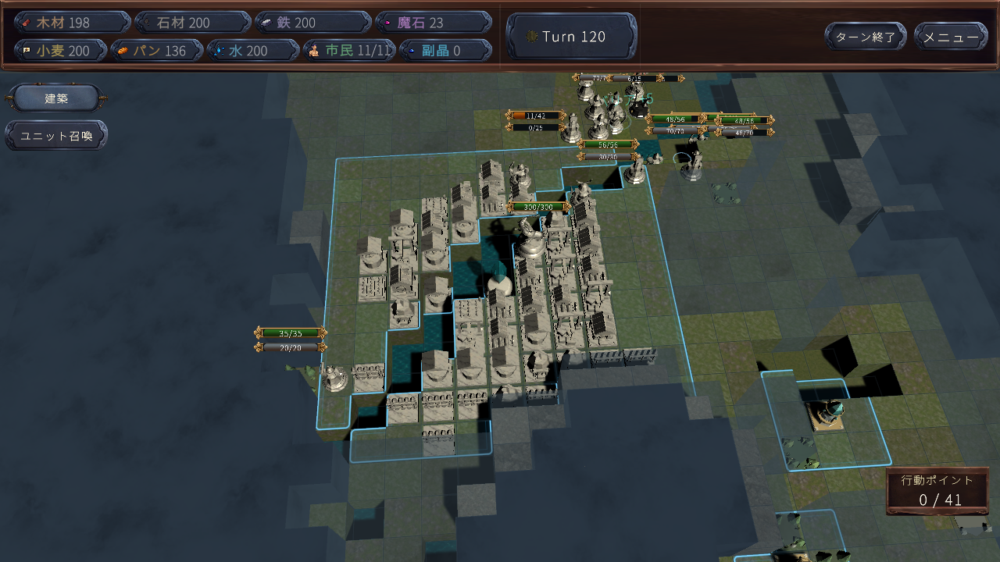

# AI挙動と戦闘停滞の実行調査（2026-11-03）

**前線の戦闘・増兵は動いています。一方、敵領土の発見から本拠点の発見・再視認・攻撃へつながらず、120ラウンドで決着しない問題を再現しました。個別の探索不具合は修正しましたが、膠着全体の解消は未達です。**

## 実行条件と証拠の扱い

- Unity 6000.3.8f1 の独立した `UnityValidation` で、通常の SampleScene「はじめから」と開発者用プレイヤーAIを実行しました。人間の手操作やコード閲覧を対戦回数に数えていません。
- プレイヤー・敵とも脅威度30、敵Combat。マップ314159/271828を、変更前・試験変更・採用修正の3版で実行。各120ラウンド・240陣営ターンが観測上限です。制御試験は通常対戦と分けます。
- AP、資源、ダメージ、バリア回復、タイマー、timeScale、AI思考予算の上書きなし。R4は本番設定どおり無効・shadow。基本作戦・部隊編成とは別の設定です。
- マップ・AIシードを固定しても、フレーム予算、観測I/O、生成個体IDによって行動経路は変わります。2マップだけで勝率や統計的有意差を主張しません。
- 選択済み行動、実行結果、観測済み目標、探索任務、部隊編成を記録しました。追加の選択ログは各24,000行で打ち切り、選択候補や経路を再生成しません。
- 本拠点間の初期地形接続は診断専用です。真の地形を読むこの診断結果をAIへ渡していません。占有・建築・駒固有移動・APを含む全経路が開いている証拠ではありません。
- `after` は不採用の配点試験、`final` が採用した修正です。変更前の基点は `ed8f2119`。正確な実行ソース・アセットハッシュは各manifestに記録しています。

## 確認できた原因・切り分け

### 1. 本拠点へ攻撃する以前の索敵で止まる（最優先、実測）

変更前314159では、両陣営とも120ラウンドを通して相手メインクリスタルの視認ラウンドが**0**。敵領土はプレイヤー79、敵87ラウンドで認識され、進軍準備完了の記録もありますが、本拠点攻撃候補は0でした。

変更前271828は、プレイヤーが9ラウンドで視認、72ラウンドで位置を記憶し、実際の本拠点攻撃は2回。敵は視認も攻撃も0です。つまり「本拠点へ撃てる候補を毎回無視する」が主要説明にはなりません。観測・記憶があっても、射程・視認を成立させる前線を維持できていません。

**再現**：同条件で通常NewGameを開始し双方AI、120ラウンド。`objectives-by-turn.csv` の視認・候補数を、実行済み攻撃と照合。

**改善案**：敵領土発見後は、本拠点発見まで維持する偵察任務と護衛を用意し、境界へ近づいた回数ではなく「未確認領域の確認」「本拠点の再視認」を成果にする。未視認の本拠点座標を取得しないこと。副作用は偵察・護衛に使うAPと前線防衛の減少なので、実際の脅威で中断・再開を検証する必要があります。

### 2. 防衛モード固着・経済破綻だけでは説明できない（実測）

変更前の敵は314159で174、271828で188のターン遷移スナップショットが `StrategicAttack`。`EmergencyDefense` はどちらも0でした。ターン記録で飢餓・未払いは0。敵は46/50施設を建設し、61/54体を召喚しています。「3体しか作らない」「何もせず防衛している」は今回の条件では再現しません。

61～120ラウンドに敵が実際に攻撃へ払ったAPは813/1038、移動は709/444。戦闘しているのに本拠点へ届かない、**前線の消耗戦**です。モード名や接近回数だけを作戦成功と扱えません。詳細は [late-ap-summary.csv](late-ap-summary.csv)。

**改善案**：部隊の任務ごとに、主力を前進させるAPと偵察APの割当を観測する。通常の敵撃破、敵領土接近、本拠点発見、本拠点HP減少を別の成果として追う。共通APを増やして隠す修正は行っていません。

### 3. 部隊は存在するが、決着に向かう連携の実証が弱い（実測＋限界）

変更前に実稼働4駒の部隊を確認しました。選択時の部隊ID、所属駒、生存人数も記録しています。R4無効を理由に「部隊AI全体が無効」とは判断できません。一方、複数手の協調攻撃計画は条件別で最大1～2段階で、3～4駒の連続撃破や本拠点への連続攻撃が十分機能するとは判定できません。[operation-summary.csv](operation-summary.csv)

**改善案**：部隊人数だけでなく、同一目標への接近、射線確保、攻撃順、支援後の攻撃、実ダメージを測定する。計画した攻撃用APが無関係な移動へ消費されないケースを制御試験で追加する必要があります。集結を厳格にしすぎると、待ち合わせ自体が新たな停滞を生みます。

### 4. HP増加はダンジョン報酬だった（実測、仕様変更なし）

変更前271828の敵メインクリスタルは、38/48/58ラウンドに最大HPが3000→4000→5000→6000へ増加しました。呼出記録は `DungeonSystem.ProcessTurn → GrantArtifact → BuffCrystal`。初期HP移行が繰り返されている現象ではありません。[crystal-capacity-events.csv](crystal-capacity-events.csv)

採用修正314159ではプレイヤー本拠点が最終HP11000となるケースもありました。基本HP3000と、取得報酬による増加は区別が必要です。この蓄積は長期戦で必要攻撃量を増やします。ただし、現行報酬の意味を勝手に削除・上限化していません。

**改善案**：本拠点HPの増加源を表示し、報酬の重複上限・増加量・獲得間隔をバランス項目として検討。上限を付ける場合はダンジョン攻略の価値が下がるため、AI探索と切り分けて評価する必要があります。

## 再現して修正した個別不具合

以下は**制御された実行試験で原因と修正を確認したもの**です。通常対戦での自然発生頻度を算出できた、という意味ではありません。

| 不具合 | 再現条件と原因 | 採用修正 | 副作用・限界 |
|---|---|---|---|
| 一時的な凍結で探索任務を失う | 探索中の駒へFreeze。適格駒リストから外れ、死亡と同じ `unit_lost` になる | 駒と目標を保持して一時停止。解除後は同一目標へ復帰し、停止期間を停滞時計から除外 | 本当に不在の駒は従来どおり任務を解放。長期戦全体を直す修正ではない |
| 岩場を通れる既知経路として扱う | 観測済みの移動不可Rockを置く。地形種別だけで通行可否を作っていた | 自陣営が知る環境定義の移動不可を反映 | 隠れた環境の位置をAIへ教えない |
| 森越しの探索成果を過大予測 | 歩行可能・視界遮断Forestを観測。移動不可集合を視界遮断にも流用していた | 移動と視界の遮断を別に保持。森は歩行可・視界不可 | 河川が移動不可だから視界も遮断、と扱わない |
| 視界0の駒へ探索加点 | 視界0効果中、既知セルへの移動なのに既定Scout視界で新視界を予測 | 役割・性格・戦略・方向評価・認知へ実際の駒を渡し、視界0の足跡も反映 | 他の正当な移動目的までは禁止しない |

変更箇所は `Assets/Script/Gamesystem/TurnSystem/Enemy/` 以下の `AIReconnaissance.cs`、`AIRoleAssigner.cs`、`AIPersonalityScoring.cs`、`AIStrategyBonus.cs`、`AIOrientation.cs`、`AICommander.Cognition.cs`、`Exploration/AIExplorationPlanner.Board.cs`、`Exploration/AIExplorationPlanner.cs`。

`Tests~/AIStallContracts.cs` の制御試験は**25項目成功**（両陣営、停止復帰、保存復元、死亡時の解放、視界0、未発見環境の非参照、観測済み岩場・森）。`SquadCoreValidation.Run` も成功。Runtime/Editor/Releaseの静的コンパイルも成功しました。静的コンパイルをプレイ検証とは数えません。

## 採用しなかった実験

探索加点を永続探索プランナーへ一本化し、目標へ進む再訪を履歴ペナルティから除外する試験も実行しました。しかし314159では、移動が954/895→1286/1394、攻撃が327/257→80/118、往復が7/1→12/14へ変化し、120ラウンド未決着でした。

この比較だけで単一変更の因果は断定できませんが、改善の根拠にはできないため、**その配点変更・再訪除外は採用していません**。試験の `after` 結果も隠さず保存しています。短い制御試験の成功だけで全体のAIが改善したとは扱いません。

## 実戦結果と残る問題

[match-summary.csv](match-summary.csv)、[objective-summary.csv](objective-summary.csv) に全試行の値があります。全試行が120ラウンド上限で未決着です。採用修正後も本拠点攻撃の不足は残り、**決着性の改善は未確認**です。今回は全18職種の固有スキル、別難易度、別性格、長期学習履歴のある対戦を網羅していません。

| 版・マップ | 通常攻撃 プレイヤー/敵 | 本拠点攻撃 プレイヤー/敵 | 往復検知 プレイヤー/敵 | 結果 |
|---|---:|---:|---:|---|
| 変更前314159 | 327 / 257 | 0 / 0 | 7 / 1 | 120R未決着 |
| 変更前271828 | 493 / 344 | 2 / 0 | 0 / 1 | 120R未決着 |
| 不採用試験314159 | 80 / 118 | 0 / 0 | 12 / 14 | 120R未決着 |
| 不採用試験271828 | 403 / 378 | 0 / 0 | 0 / 4 | 120R未決着 |
| 採用修正314159 | 417 / 241 | 0 / 0 | 0 / 0 | 120R未決着 |
| 採用修正271828 | 337 / 229 | 0 / 0 | 1 / 4 | 120R未決着 |

全6試合のゲーム実行中のError/Exception/Assertは0。Editor終了処理のフォント関連警告は、AI実行中の例外とは分けています。採用修正で往復が減ったマップもありますが、別マップでは減っておらず、安定して改善したとは判定しません。煙・焼却後の動的環境を含む全視界ケースは今回未検証です。

優先順位は、①本拠点を探し直す継続任務、②実際の成果を出す部隊のAP配分・攻撃順、③ダンジョン報酬の耐久蓄積、④建築による密集と動線です。④は画面で多数の施設を確認しましたが、建築が主因で進路を塞いだ頻度は未計測です。初期の地形接続があることだけでは否定できません。

## 再実行

既存の `AIClosingPlaytest.Run` を通常どおり実行すると、追加の `stall-choices.csv` と `stall-scouts.csv` が出ます。`FK_CLOSING_EXPLORATION_JSONL=1` で探索の詳細履歴も保存できます。

`QualityAuditSession.Run` に `FK_AI_STALL_CONTRACTS=1` を渡すと、通常NewGame初期化後に制御試験を実行します。これは通常対戦とは別の試験です。

完全なCSVとEditorログは開発環境の `work/ai-stall-{baseline,after,final}-20261103-matches`、`work/a1-20261030` に保存。リポジトリには結果JSON、集計、目標・領土履歴、試験成功行、ソースmanifestと代表画面を収録しました。
