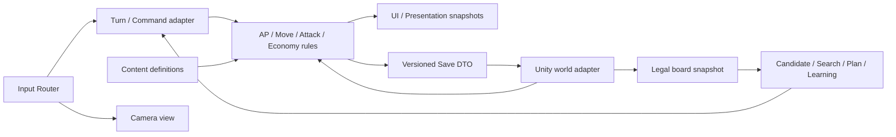

# Fantasy Kingdom の責務と状態の正本

2026-10-11。Unity 6000.3.8f1 / 保存形式7。設計判断と互換手順は `ADR/`、保存仕様は `Save_Format.md` を参照。

## 状態の所有者

| 状態 | 正本 | コピー・派生状態 |
| --- | --- | --- |
| 資源・AP・国家の成長・人口上限 | `FactionState` / `NationState` | HUD、経済予測、Save DTO |
| 駒のHP・Lv・状態効果・同一ターン内の使用済みフラグ | `Status` | 頭上UI、AI観測、Save DTO |
| 駒の位置・地形 | 実行アダプターのTransform / `MapCreate` | 占有索引、探索経路、カメラ |
| ターンと再開位置 | `TurnGenerator` / `GameContext` | Timer UI、ログ |
| 現在の視界・探索済みマス | `VisionGenerator` | AIの合法観測、Fog表示 |
| 作戦・反省・探索の戦闘内状態 | 各AI subsystem | 日記snapshot、戦闘Save DTO |
| 対戦を越える学習 | 各versioned learning profile | 戦闘中の評価値、日記 |
| 正式な制作・バランス定義 | 登録Catalog・UnitData・FacilityDefinitionData・Rules | UI、AI予測、生成済みStatus |

`UnitRegistry`、移動/攻撃候補、Mesh、UI、Coroutine、カメラ、Profilerリングは正本ではない。消去して再生成できるデータを保存の代わりにしない。

## 依存の境界

現在は `Assembly-CSharp` に既存コードが集まっている。全面的なasmdef分割は行わず、既存のScene・Prefab・GUIDを維持した。純粋な保存キー・ファイル保存境界・乱数インターフェースはUnity型を必要としない。AI Boardと実行アダプターにはまだ `Vector3` / `Status` / Transform依存があり、完全なheadless Coreではない。

AIの判断クラスはUI/TMP/カメラを参照しない。`EnemyStart` はターン進行の表示アダプターで、バナーを操作する。Battle/Skillの既存実行アダプターには通知が残る。新しい判断処理から表示クラスを呼ばず、既存の観測・実行イベント境界へ接続する。

## 入力と時間

キーボード/ポインターは `TurnInputHandler` で読む。PlayerMoveは毎フレーム更新されるGameContextのコマンド値を読む。C/Tab/Z、左右Shift、メニュー、隠しショートカットの定義を中央へ集約した。Camera/Inspectionは同じポインターsnapshotを使う。描画座標、ズーム、見下ろし切替はルール状態へ書き戻さない。

ルールのターン数はGameContext/NationState、制限時間はTimerSystemが所有する。`DateTime` は保存/日記/ビルドの記録日時に限定する。AI乱数は `IRandomSource` を実装する `AIDeterministicRandom`、アルゴリズム識別は `system-random-v1`。マップ・初期配置・一部SkillのUnity.Randomは既存のまま残る。完全なプラットフォーム横断Replayの保証はない。

## 参照・イベントの寿命

- TurnGeneratorがInputイベント、GameAction、AI runtime、Undoを所有し、OnDestroyで解除/破棄する。
- CameraはOnEnable/OnDisableでSceneイベントを購読/解除する。
- MoveUndoSystemはIDisposable。匿名イベント購読を廃止し、APイベントを確実に解除する。
- 一時的なUI・表示キューはScene所有。日記は非表示時に描画やファイル読込をしない。
- ObjectPool、UnitRegistry、MatchStats、AchievementSystemなどのSingletonは既存互換のため維持する。新規Singletonを増やさない。静的Catalog cacheはSubsystemRegistration/OnValidateの明示リセットを持つ。

## 拡張時の検査

保存形式・ID・ルール・AI学習を変更する時は固定fixtureと回帰テストを先に走らせる。巨大ファイルの行数だけを理由に分割しない。`AICommander`、`AIBoardState`、`AIOperationManager`、`WildBossSystem`、`Status` は責務分割の候補だが、今回一括Rewriteしていない。部分クラスは公開APIのファサードとして扱い、同じ責務の第二Managerを作らない。
