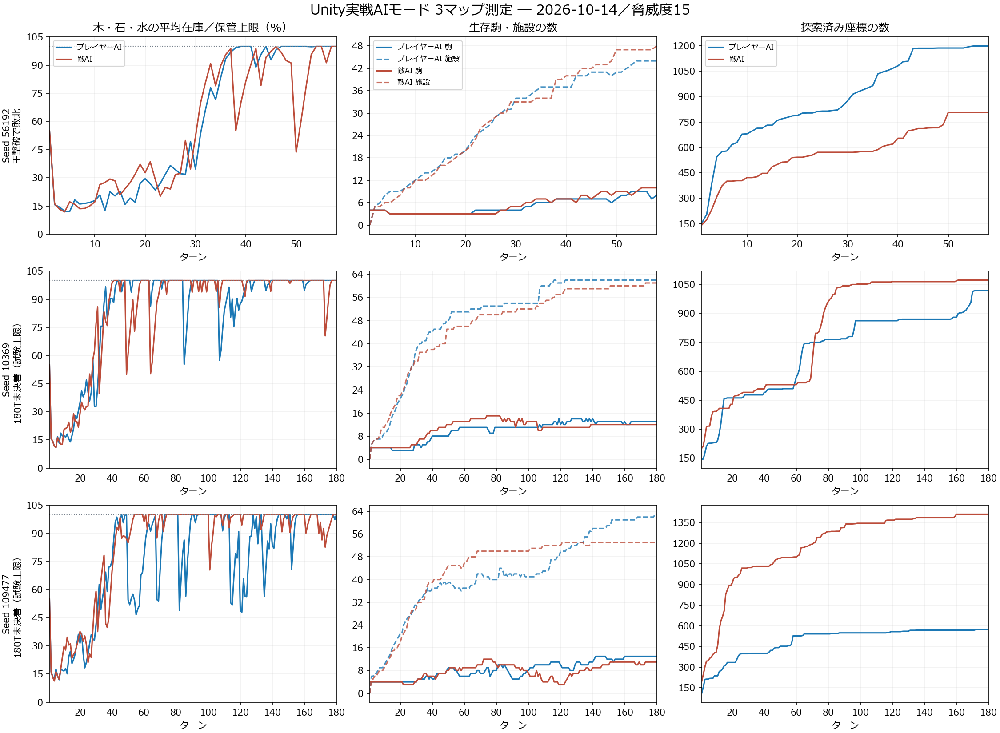

# AIモード実戦によるゲームバランス確認 — 2026-10-14

UnityのPlayモードで通常の「はじめから」ボタンを実行し、開発者用プレイヤーAIをONにして3マップを進行させた。戦闘・建築・召喚・第三陣営ターンは実際のゲームシステムを使った。机上シミュレーションだけの結果ではない。

現行の資源量・生産量・維持費・戦闘値・AI思考予算を変更せずに確認した。ゲーム本体の調整はこの試験では行っていない。結論は、**資源の余りとAIの経済偏重が残っており、バランス改善は完了していない**。

## 実行条件

- Unity 6000.3.8f1、検証用コピーのSampleSceneをPlayモードで起動。ユーザーの開いているUnityとセーブは操作していない。
- 各試合で保存先を分離し、未学習の新規プロフィールから脅威度15で両AIを初期化した。プレイヤーAIは通常のDeveloperPlayerAIControllerを使用した。
- 開発者試験フラグで対戦結果による本番プロフィールの進行・学習保存を除外した。通常ゲームの行動ルールや予算は変更していない。
- 敵の性格・乱数は通常初期化で決まる。マップ入力seedだけでは完全再現条件にならないため、実際の地形seed・敵AI seed・性格もmatch.jsonへ記録した。
- 自然なゲーム終了、180ターン上限、30分上限、120秒のターン進行停止を区別。試験上限は引き分け・勝利として扱わない。
- 開始後の複数ターンと終了画面を実シーン＋HUDから描画して目視確認した。PNGは画面録画ではなく、同じゲーム内カメラとCanvasのRenderTexture出力である。

## 結果

| マップ入力seed | 敵AI seed / 性格 | 到達ターン | Playモード経過 | 結果 |
|---|---|---:|---:|---|
| 56192 | 325265000 / Adaptive | 58 | 145.3秒 | 敗北理由：味方の王が撃破されました |
| 10369 | 325700859 / Intellect | 180 | 555.6秒 | 試験上限・勝敗未確定 |
| 109477 | 326322906 / Intellect | 180 | 827.7秒 | 試験上限・勝敗未確定 |

到達ターン数の合計は418。ターン数はプレイヤー側のラウンド番号であり、両AIの行動回数とは異なる。

56192は58ターンで王撃破による自然敗北。最終攻撃のログスタックはBattleSystem → ThirdFactionTacticalAI → ThirdFactionSystemであり、第三陣営の通常攻撃で決着した。敗北画面の理由表示も一致した。

[58T敗北画面](PlaytestScreenshots/balance-20261014/56192/terminal.png) / [10369の160T画面](PlaytestScreenshots/balance-20261014/10369/turn-160.png) / [109477の80T画面](PlaytestScreenshots/balance-20261014/109477/turn-80.png)

## 実測で確認した問題

### 1. 余った資源が攻勢に変換されにくい

40ターン以降の開始標本で、木・石・水がすべてその時点の保管上限に達した割合を比較した。保管上限は施設により変化するため、固定200で判定していない。

| seed | プレイヤーAI：3資源同時上限 | 敵AI：3資源同時上限 | 最終生存駒 P / E | 最終生存施設 P / E |
|---|---:|---:|---:|---:|
| 56192 | 14/19（73.7%） | 4/19（21.1%） | 8 / 10 | 44 / 48 |
| 10369 | 99/141（70.2%） | 104/141（73.8%） | 13 / 12 | 62 / 61 |
| 109477 | 64/141（45.4%） | 92/141（65.2%） | 13 / 11 | 63 / 53 |

木・石・水だけでなく、小麦・パン・鉄・魔石もCSVへ記録している。10369の180Tでは味方の小麦・パンも250で上限、敵も小麦・パン225で上限だった。余剰の問題を鉄だけに限定していない。

施設数の多さだけで悪手とは断定できないが、資源を保管上限で切り捨てる処理だけでは、余剰と支出不足を解消できていない。生産量だけを下げる前に、兵力・育成・作戦へ使えているかを切り分ける必要がある。

### 2. 経済回復モードが長く続く

| seed | プレイヤーAI 回復モードの開始標本 | 敵AI 回復モードの開始標本 |
|---|---:|---:|
| 56192 | 54/58（93.1%） | 43/58（74.1%） |
| 10369 | 172/180（95.6%） | 174/180（96.7%） |
| 109477 | 172/180（95.6%） | 152/180（84.4%） |

10369の100〜180Tは、両軍とも81回すべてEconomicRecovery・StableGrowthで、パンの予測純収支もすべてプラスだった。備蓄が十分でも攻勢へ移りにくいことを実測した。

コード上、StrategicEconomyForecastは8資源のいずれかで保証生産が需要を下回るとWarningを維持でき、AIStrategicGovernorはWarningをEconomicRecoveryへ接続する。AIPlanManagerは回復中の作戦を中断する。鉱山の魔石は確率産出のため、基盤経済の期待生産と保証生産で判断が分かれる。今回の警告の原因資源を個別に記録していないため、「魔石が原因」とは断定しない。

### 3. 探索・主目標への転換と指揮官の扱い

10369は180Tでも未決着。双方の相手主陣営ユニット可視数は180回の開始標本すべて0で、クリスタルHPの減少も確認できなかった。視界はターン途中にも変わるため「一度も接触しなかった」とは断定しない。Scout不在や探索面積が増えない期間もあった。

109477では主陣営同士の接敵を確認し、味方クリスタルも15000→14985になった。敵BossはHP20000から513000まで成長し、その後80Tの開始標本で生存一覧から消えたが、勝利にはならず試合が続いた。死亡・離脱の直接原因は通常ログだけでは確定できない。

初期配置は味方King・敵Bossで、現在の決着判定MatchObjectiveRulesはKingまたはCrystalのみ。初期敵Bossは未登録種のUnitStaticData既定値（HP20000、HP成長+17000/Lv）が使われ、第三陣営イベント用BossのHP500設定とは別経路になっている。設定の読込バグやXPのオーバーキル加算とは断定しない。HP成長と勝利条件を一緒に確認すべきである。

## 次の調整優先順位

1. **作戦停止が必要な経済危機と、備蓄で支払える収支警告を分ける。** 資源別の保証生産・期待生産・必須需要・予測残高・不足理由を追加計測し、警告の原因を確定する。
2. **兵力・育成・探索へ資源とAPを割り振る。** Scout補充、警告中でも可能な探索、本目標へ向かう作戦の再開を検証し、その後に施設生産量や維持費を調整する。
3. **初期敵指揮官と決着条件・成長値を合わせて設計確認する。** Boss不在でも続行する仕様、HP急成長、第三陣営との戦闘での育成差を明示して調整する。

## 記録の読み方と限界

- CSVは原則PlayerMove開始の標本。敵側APは直前の行動後残高なので、味方開始APと単純比較しない。AI初回Tickと観測の順序により、開始行が厳密な行動前とは限らない。
- phase=terminalは同ラウンドの追加行。割合はphase=player_startのみで計算した。
- Unitsは生存Type.UnitでKing/Bossも含む。Levelsはレベル合計。Buildingsは生存施設の数。
- Buildsは新設・強化・副晶の成功行動を合算。Moves/Attacks/Skills等はCommanderがターン末にまとめるので、終局・中断直前の一部が欠ける場合がある。
- Damage/DamageTaken/LossesはMatchStatsの通常攻撃イベント集計で、建物も含む。スキル・毒・環境・クリスタル反撃など別経路のすべてを表さない。Lossesは兵士だけの損失数ではない。
- VisibleOpponentsは対立する主陣営のUnitだけで、第三陣営と建物は含まない。
- 全試行のSkills=0は、現コンテンツの固定スキル割当が未設定であることが関係する。AIが利用可能な技を避けている証拠ではない。
- 初回56192のenemyKingHP=0はKingが存在しないことを0へ変換した値。敵王死亡を示さない。2・3回目では不存在を-1としBossHPも追加した。
- 2回目CSVのthirdBattles/thirdObjectiveDamage、および3回目のpressureDamageEventsSinceSnapshot/pressureObjectiveDamageSinceSnapshotは、履歴更新後の主陣営への全攻撃圧力の途中集計であり、第三陣営の専用累計ではない。thirdUnits/thirdIPはその時点の第三陣営状態。
- 3試合は同じ脅威度でも性格・地形・初期駒が異なる。勝率や対人バランスを統計的に確定する本数ではない。フレーム時間・ファン音の測定でもない。
- 再実行前の計測コードにCommander初期化待ち不足があり一度停止した。待機処理を修正して再起動した成功試行のみを上の3試合に数えた。

## 保存したデータ

- [集計JSON](PerformanceData/balance-20261014/summary.json)
- [56192 CSV](PerformanceData/balance-20261014/56192/turns.csv) / [条件と結果](PerformanceData/balance-20261014/56192/match.json) / [Unityログ](PerformanceData/balance-20261014/56192/unity.log)
- [10369 CSV](PerformanceData/balance-20261014/10369/turns.csv) / [条件と結果](PerformanceData/balance-20261014/10369/match.json) / [Unityログ](PerformanceData/balance-20261014/10369/unity.log)
- [109477 CSV](PerformanceData/balance-20261014/109477/turns.csv) / [条件と結果](PerformanceData/balance-20261014/109477/match.json) / [Unityログ](PerformanceData/balance-20261014/109477/unity.log)
- 計測用ソース: Tests~/BalanceMatchStudy.cs。通常Assetsには入れず、検証用コピーのEditorフォルダだけで実行した。
