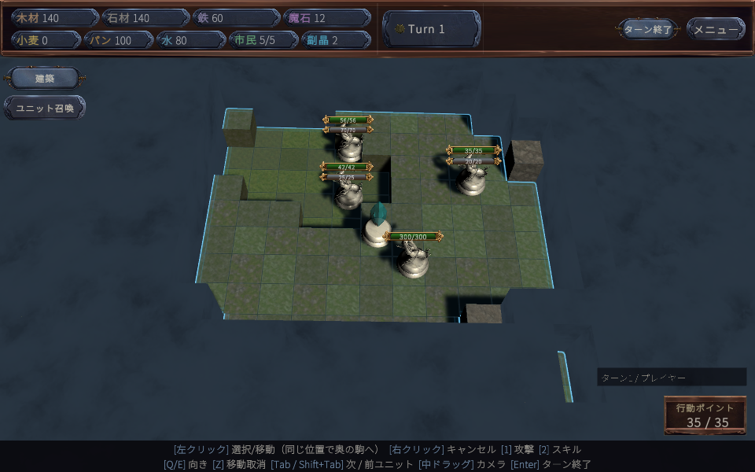
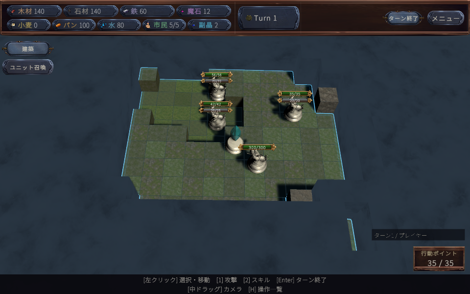
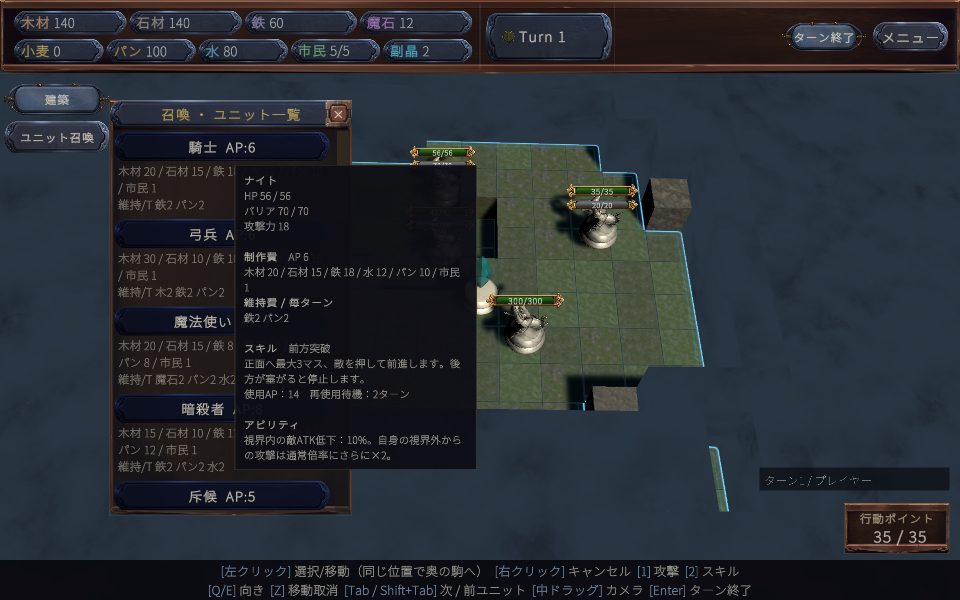
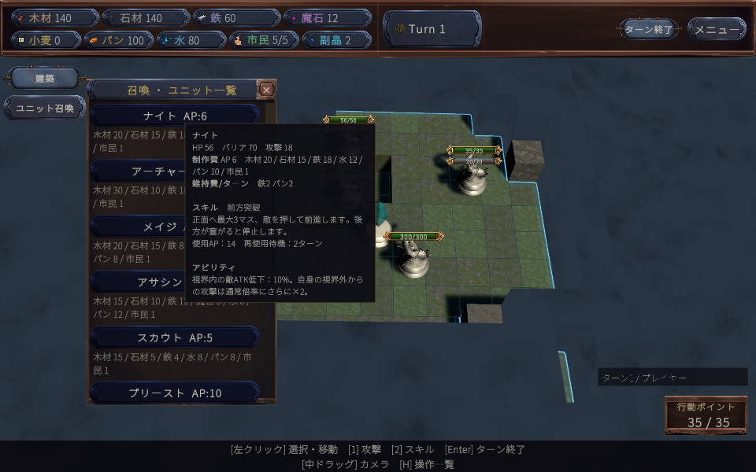
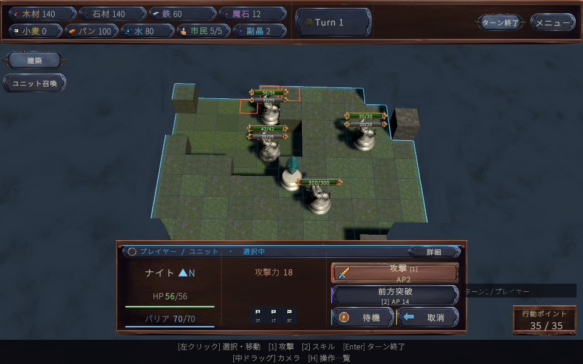
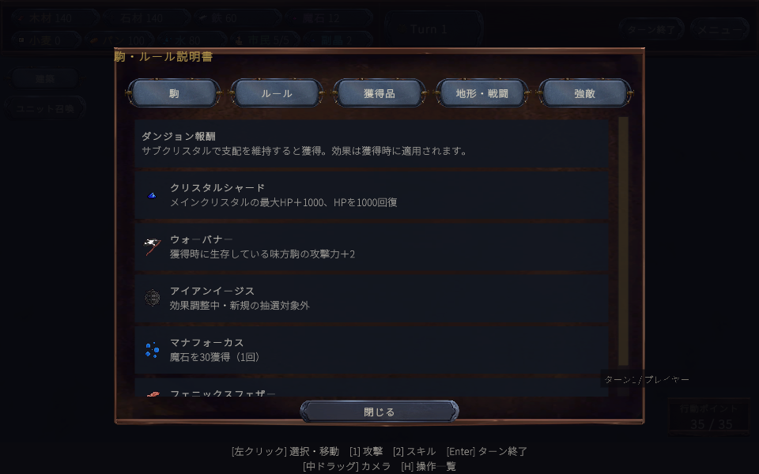
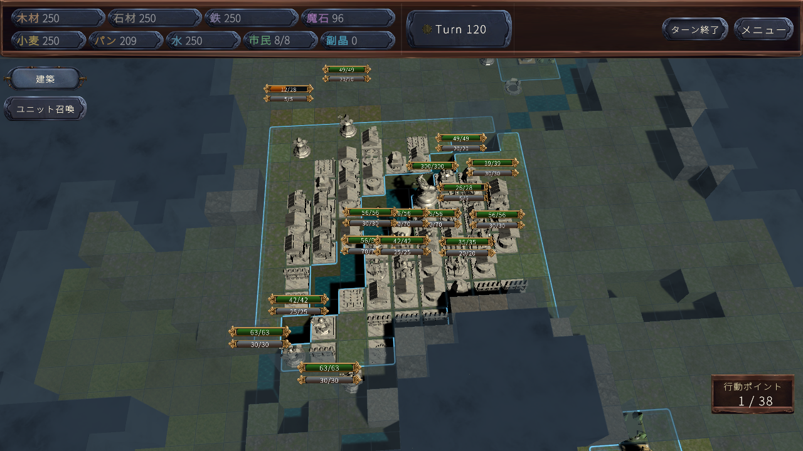

# Fantasy Kingdom 実戦品質調査・修正記録（2026-11-03）

**UIの文字量と表示不整合、クリスタルのAI評価、ダンジョンの空振り報酬を修正しました。長期戦の膠着は残っています。AIが強くなった・バランス調整が完了した、とは判定していません。**

## 実行した範囲

- Unity **6000.3.8f1** の別プロジェクト `UnityValidation` で実行。通常の SampleScene の「はじめから」と開発者用プレイヤーAIを使用しました。コードレビューを実戦回数に数えていません。
- 修正前3試合、修正後3試合。プレイヤーAIは実際のプロジェクト設定の**脅威度30**。敵30・Combatをシード314159/271828、敵45・Growthを161803で実行しました。
- 30対30は各120ラウンド・240陣営ターン、30対45は各80ラウンド・160陣営ターンまで。**全6試合が観測上限で未決着**。試合終了や勝利として数えていません。
- AP・資源・ゲーム内タイマー・timeScale・AI思考予算のテスト用上書きはありません。マップとAIのシードを固定していますが、フレーム予算に依存する探索と追加観測ログのため、対戦経路の完全再現性はありません。
- 新しいR4層は実データで `enabled=false / shadow=true`。今回の結果をR4全機能の実戦評価とは扱いません。
- 実際のUIを1280×720と960×600で描画。修正後28画面、ホバー初回・再表示を両解像度で確認。通常の選択・メニューボタンのコールバックを実行しています。人間によるマウス操作・初見理解の試験ではありません。
- 状態異常3個を付けた画面は**制御された表示試験**です。自然な対戦中にその3効果が同時発生した証拠ではありません。元の効果リストへ復元しています。
- 18職種の本番データ72行と、実際のDamageCalculator/AP/バリア処理を使う1,368組の限定的な通常攻撃交換を確認。射程・地形・移動・能動スキル・経済を省いた交換試験なので、職種の総合勝率ランキングではありません。

## 評価

| 項目 | 評価 | 確認した問題 | 優先度 |
|---|---|---|---|
| AIの戦闘判断 | 要改善 | 戦闘・回復は実行するが、勝利対象への集中と探索完了が弱い | 高 |
| AIの経済判断 | 一部機能・要改善 | 増兵と支援役の生産を確認。施設数・余剰在庫が大きい局面がある | 高 |
| 職種バランス | 部分検証 | 18職種の設定取得済み。全固有スキルの自然な実戦使用は未確認 | 中 |
| 経済バランス | マップ依存 | 非交戦時は在庫が膨らみ、交戦時は鉄・魔石が厳しい。一律の維持費増加は不適切 | 高 |
| UIの視認性 | 改善 | 資源・状態異常・獲得品のアイコン追加、AP見出しの余白不足を修正 | 中・対応済み |
| UIの理解しやすさ | 改善 | 操作一覧の折り畳み、召喚説明の整理、名称と実効果の不一致を修正 | 中・対応済み |
| ゲームテンポ | 要改善 | 80～120ラウンドで決着せず。Editorで長いフレームも観測 | 高 |
| 総合完成度 | 開発継続 | 今回の修正は導入可能。決着性と全職種の対戦網羅は未完 | 高 |

## 実戦結果

「主目標攻撃」は相手の王またはメインクリスタルの実際の個体IDに対する攻撃です。中立ボス・施設への攻撃を混ぜていません。

| 条件 | ラウンド | 通常攻撃 プレイヤー/敵 | スキル プレイヤー/敵 | 主目標攻撃 プレイヤー/敵 | 結果 |
|---|---:|---:|---:|---:|---|
| 修正前・314159・敵30 | 120 | 70 / 22 | 16 / 2 | 0 / 0 | 未決着 |
| 修正前・271828・敵30 | 120 | 381 / 379 | 32 / 30 | 11 / 0 | 未決着 |
| 修正前・161803・敵45 | 80 | 179 / 220 | 8 / 6 | 0 / 0 | 未決着 |
| 修正後・314159・敵30 | 120 | 220 / 201 | 8 / 7 | 0 / 0 | 未決着 |
| 修正後・271828・敵30 | 120 | 376 / 432 | 33 / 16 | 0 / 0 | 未決着 |
| 修正後・161803・敵45 | 80 | 64 / 113 | 0 / 7 | 0 / 0 | 未決着 |

最終試行6試合のゲーム実行中のError/Exception/Assertは0。未払いは修正前271828のプレイヤーで記録時点最大1体・連続1回を確認。他の5試合のターン記録は0。いずれも記録時点の飢餓は0です。ターン間の全瞬間までゼロだったという意味ではありません。

修正前の314159はプレイヤー最大19・敵最大15体の戦闘駒、回復役は双方最大3体。修正後の271828はプレイヤー最大9・敵最大14体、回復役最大4/3体でした。**「3体しか作らない」「回復役を一切作らない」は今回の条件では再現しません。** 最大軍隊数は指揮官を除く観測値です。

白魔導士の回復スキルの選択・実行記録があります。修正前314159はプレイヤー14回・敵2回、修正後271828は9回・1回。回復イベントには自然回復・泉・プリースト等も混ざるため、単純なHP回復回数をすべて回復スキルの成果として集計していません。

詳細値は [match-summary.json](match-summary.json) と [role-runtime-data.csv](role-runtime-data.csv)。職種数、交換試験の除外事項は [role-method.json](role-method.json) にあります。

## 修正した問題と再現方法

### 1. 相手クリスタルHPを100で割って評価していた

- **原因確定**：`AIBoardEvaluator.EvalCrystalSafety` の相手HP割合だけが固定の `HP / 100`。最大HP3000なら満タンを30倍として扱っていました。自陣側は最大HPで正規化していました。
- **再現**：制御された観測試験で、相手クリスタルを公式視界に入れる。HP5000/5000と10000/10000を比較すると、修正前は相手項の尺度が変わるコード経路でした。
- **修正**：観測アダプターで視認中の最大HPだけを公開し、`HP / 観測最大HP` を0～1に制限。非視認時はHPと最大HPをともに-1に戻します。隠れたクリスタルの最大HPを読んで補完していません。
- **確認**：両陣営で満タン同士の評価一致、25%で相手項が30変化、視界外への移動・HP変更・記憶否定を含む30項目がNative Play Modeで成功。
- **頻度・影響**：相手メインクリスタルを視認する評価経路で発生。自然試合の膠着すべての原因とは断定しません。
- **副作用**：既存の学習・探索が受け取るスコア尺度が本来の割合へ戻ります。隠れた対象を新規に攻撃可能にする変更はありません。

### 2. 効果のないダンジョン報酬と説明の相違

- **原因確定**：抽選5種中、IronAegisは廃止済みDEFを加算、PhoenixFeatherは廃止済み専用シールドを戻す経路。既存の現行ルールでは有効な報酬効果を提供しません。ManaFocusの説明は「毎ターン+3」でしたが、実処理は獲得時の魔石+30でした。
- **再現**：隔離した両陣営の実コンポーネントでGrantArtifactを呼び、資源・駒ATK・クリスタルHPを確認。通常試合で何回その報酬が出たかは今回未集計です。
- **修正**：効果未調整の2種を新規抽選から除外。古いセーブの未受領報酬が該当する場合、受領時に現行の3種へ再抽選。Enum値を削除・並び替えしていません。説明を実効果と統一し、獲得履歴を既存のセーブ対象へ記録します。
- **確認**：両陣営で魔石+30、現存駒ATK+2、クリスタル最大HP+1000と回復1000、履歴の陣営識別、旧効果の受領拒否を確認。
- **副作用**：有効な3種の相対抽選率が上がります。既に適用済みの古い報酬を遡及して差し替えません。過去のダンジョン報酬は履歴が保存されていなかったため、過去分の所持数は復元できません。

### 3. 操作説明と召喚画面の情報密度

- **証拠**：下の前後画像、および [ui-comparison.json](ui-comparison.json)。960×600の同じ状態で測定しました。
- **再現**：「はじめから」→召喚→ナイトへホバー。通常表示では詳細な操作説明と維持費が反復されます。
- **修正**：操作説明は主要コマンドと `[H] 操作一覧` に整理。全操作はHで表示可能。制作費は一覧に残し、維持費・ステータス・スキル・アビリティはホバーへまとめました。最大HPを `56/56` と繰り返す表示を `HP56` に短縮。
- **測定**：通常画面の可視文字220→168（約24%減）、召喚一覧416→359、ホバー584→519。文字数は実際に画面内に描画された字形の数で、理解度の点数ではありません。短くした結果、多くの行が見えるため、一覧全体の削減率だけで評価していません。
- **副作用**：維持費を見るにはホバーが必要。タッチ操作への最適化は未検証。スキル・能力の本文は削除していません。

| 修正前 | 修正後 |
|---|---|
|  |  |
|  |  |

### 4. 名称・表示枠の不一致

- 召喚一覧の旧名称（騎士/弓兵など）と選択パネルの本番定義名（ナイト/アーチャー）が異なっていました。一覧もUnitData.DisplayNameを使用し、スタジオで編集した名前を反映します。
- アーチャーの能動スキルの本番表示名が、常時能力を示す「未移動強化」でした。既存の実効果に合わせ「毒霧の退避」に変更。AP・クールダウン・効果は変更していません。
- 開発者AIは実際の脅威度30に対し、ヒントが15固定でした。設定値から表示するよう変更。
- AP見出しはテーマ適用後に余白が不足し、両解像度でTMPのOverflow判定がありました。上余白を調整。修正後の比較対象画面でOverflow候補は0です。
- 頻度：各画面を開くたび。副作用：名称・配置のみ変更し、駒の識別Enumや保存IDは維持しています。

### 5. アイコン導入

- ローカルにある **Admurin's Pixel Items** の単体スプライトを31キーへ接続。新しく生成した透過パン画像と合わせ**32キー**を登録しました。
- 資源はアイコンと短い日本語を併記。数の正確な値をホバーで確認できます。
- 選択中の状態異常は最大6枠の再利用バッジで表示。残ターンとホバーの日本語名、既存の「詳細」画面を利用できます。過剰分は+Nへ集約。
- メニューの「駒・ルール説明書」→「獲得品」に、報酬の絵・実効果・記録済みの獲得数を表示。既存の固有レリックも履歴から表示します。未実装のポーション使用・アイテム所持システムを実装済みとは扱っていません。
- `GameIconCatalog` はResourcesから1回読込み、辞書で参照。素材パック全体の実行時検索・全画像のロードは行いません。未導入環境では日本語テキストへフォールバックします。
- この変更で購入パックの原画像を新規コピー・追加していません。既存のインストール先を参照し、生成カタログはローカル生成。接続メニューは **Fantasy Kingdom → 表示 → アイコン素材を接続**。

## 残る問題・改善案

### P1：勝利対象への到達と決着性

- **実測**：6試合とも観測上限で未決着。主目標への攻撃は修正前271828のメインクリスタル11回のみ。修正後3試合は0回です。攻撃回数が増えたことを「AI改善成功」と判定しません。
- **再現条件**：上のシード・難易度・本番設定で開発者AI対戦を80～120ラウンド実行。
- **原因の分離**：314159の修正前は地形だけなら拠点間が接続し、隣接地形ルート18歩。通行地形の初期分断ではありません。ただしこの診断は駒固有の移動マスク、占有、後からの建築を含みません。プレイヤーは120ラウンドずっと相手本拠点未発見、敵も領土発見は111ラウンド目。視界にない本拠点を攻撃しないこと自体は正常です。
- **推定**：探索先の再割当、第三勢力との交戦、進軍経路、回復待機、部隊の再集合を合成した停滞。単一原因までは確定していません。修正後は探索JSONLも取得し、ターン120で未発見目標への長距離探索が継続している記録があります。
- **具体案**：観測済み領土からの探索と主力の前進について、候補・経路・安全判定・AP実行を同じ作戦IDで追跡し、停滞した段階だけを修正する。副目標交戦で主力全員が拘束されない配分を検証する。
- **副作用**：攻勢を一律に強めると、王の突出・補給不足・中立勢力への自殺行動を再発させます。今回それを避け、ルールや防衛条件を強制的に削っていません。

### P1：経済投資と戦力への転換

- **実測**：314159の修正前は建築55/53回、非交戦局面で木・石・鉄・水の在庫が上限付近に推移。271828の交戦局面は鉄・魔石が薄く、プレイヤーで一時的な維持費未払いも発生。
- **推定**：投資時の需要見積もりと、後の戦闘消耗・増兵計画の差が、施設数や資源別の偏りを作っています。現在既に「不足改善にならない生産施設を拒否する」条件があり、無条件建築が原因とは断定できません。
- **改善案**：投資後の実回収量と予測需要を施設種別に比較し、在庫上限で失われた生産、実際に増えた兵、補給停止の3指標を優先度学習へ入れる。鉄・魔石と木・石を一括で増減しない。
- **副作用**：建築抑制を強くすると、消耗戦から再建できなくなる可能性。今回、維持費・生産量・制作費の一律変更は行っていません。

### P1：長いフレームと長時間運用

- Editor対戦のP95は約9.6～26.1ms、最長フレームは約0.42～1.33秒。初期と終了のメモリ差は約11～55MBでした。計測ログ・Editor・テクスチャ等も含み、製品ビルドの性能値ではありません。修正後は追加の探索ログが有効なため、前後のFPS改善を主張しません。
- 終了ログにUnityのMemoryLeaks集計があります。今回の数十分の対戦だけで、ゲームコードのリークと特定したり、解消したとは言えません。
- 改善案：製品相当のDevelopment BuildでProfilerを取り、AI生成・探索・視界・UI更新・Editor計測を分離。長時間反復試験で同じラウンド条件の保持オブジェクトを比較する。

### P2：職種と集団戦の網羅

- 通常試合で全18職種・全固有スキルの使用は網羅していません。重戦士・竜騎士の固有攻撃は今回の自然試合では0回。存在・通常ダメージ・限定的な反撃試験と、能動スキルを使った集団戦の強さは別です。
- 18職種の固定HP・ATK・バリア・費用・維持費・スキルAPはCSVに記録。Lv1/10/50/100で同値になることを確認しています。レベル差による性能比較は現行ルールでは意味を持ちません。
- 3～4体の編成、退却からの再集合、回復役を含む包囲の成功率は今回確定できません。作戦ログには担当割当がありますが、R4の複数段階部隊計画は本番で無効です。
- 改善案：同じ地形・視界・APで、近接/遠距離/回復/対バリアを含む3～4体対3～4体の制御試験を加える。役割の違いを残し、1対1の通常攻撃結果だけで全職種を均一化しない。

## 未検証事項

人間の初見理解、実マウスの操作負担、タッチ対応、製品ビルド、数時間～一晩のメモリ推移、難易度ごとの勝率、全職種スキルの自然な実戦使用、全コード経路の不可視情報監査は未検証です。初期UI監査時は正規視界内の敵と既存建物が存在せず、その選択画面を当該UI試験では検証できていません。

国家安定度・反乱を実装済みとして評価していません。資源・AP・視界・ダメージ・召喚上限2体・召喚直後の攻撃禁止・メインHP3000/サブ1000の基本ルールは変更していません。

## 変更箇所と検証の追跡

- UI：`UIBuilder`、`InputHintUI`、`BuildSummonUIBuilder.AuthoredUnits`、`SummonUnitTooltip`、`UnitPanelUI`、`ResourceValueTooltip`、`GameManualUI`。
- アイコン：`GameIconCatalog`、`EffectIconStrip`、Editorの`GameIconInstaller`、`Resources/UI/Icons/Bread.png`。カタログの手動上書きは接続時に保持します。
- AI：`AIBoardState`、`AIBoardState.MainCrystal`、`AIBoardEvaluator`、開発者AIのヒント。
- 報酬：`DungeonSystem`、`ArtifactPresentation`。アーチャーの本番スキル名1件。
- テスト：`A1ReconTests`、`QualityGameplayChecks`、`QualityAuditSession`、`UIQualityAudit`、表示文言を検証する既存`R2TimerUIRulesTests`。対戦レポートにプレイヤー側脅威度も記録。
- UIキャプチャは独立Overlay Canvasも含むよう計測を修正。解像度変更直後の頭上UI再配置を待って撮影しています。計測側の不備をゲーム側の欠陥として報告していません。
- 初回の追加コード試験では入力APIとパン画像のインポートに不備がありました。新Input Systemと2D Sprite設定へ修正後、最終UI実行は終了コード0、認識・報酬・素材接続53項目成功。ホバーは初回と再表示で本文が収まることを両解像度で確認。
- 既存のNative Core回帰試験も終了コード0（CoreLogic 59成功・0失敗、適応方針16項目、召喚制限等を含む）。短縮前のツールチップ表記を固定していた2つの文字列検証は、新表記に更新して再実行しました。Runtime/Editor/Releaseの静的C#コンパイルも成功。静的コンパイルはプレイ回数に加えていません。
- `match-summary.json` のフォルダ名に対応するローカル実行記録には、`actions.csv`、`turns.csv`、`nation-economy.csv`、`units.csv`、`skills.csv`、`operation-orders.csv`、`objectives-by-turn.csv`、スクリーンショットがあります。巨大な生ログはこのコミットには含めていません。

## 生成画像の記録

パンはimagegenで新規生成し、透過alphaを維持してプロジェクトへ保存。原画像1254×1254、Unityでは最大64px・Point・MipMapなしで使用します。

使用プロンプト：

> Create ONE production-ready inventory resource icon for a dark fantasy chess strategy game: a single rustic golden-brown loaf of bread with three diagonal scoring cuts, slightly angled three-quarter view, instantly readable at 24 pixels. Handcrafted crisp 32x32 pixel-art vocabulary, sharp square pixel clusters, restrained warm palette, deep brown outline, subtle top-left highlight, no antialiasing, no lettering, no border, no panel, no additional objects, no floor shadow. Centered with generous 12% transparent padding on all sides. A truly transparent alpha background. Match the readability of classic RPG pixel inventory sprites, not a rendered photograph. Square canvas, isolated bread loaf only.

添付のChatGPT会話URLはこの環境から本文を取得できませんでした。その会話の内容を読んだ前提では制作していません。許可された既存素材パックと、新規生成したパンを使用しています。
