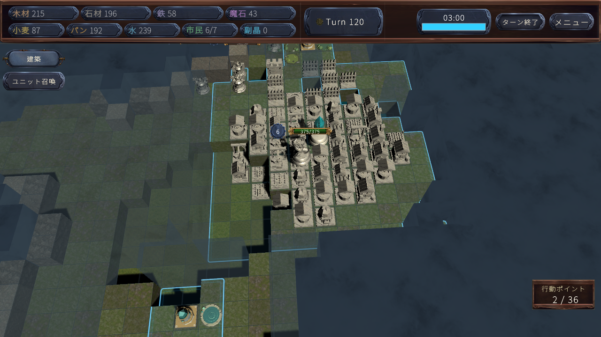
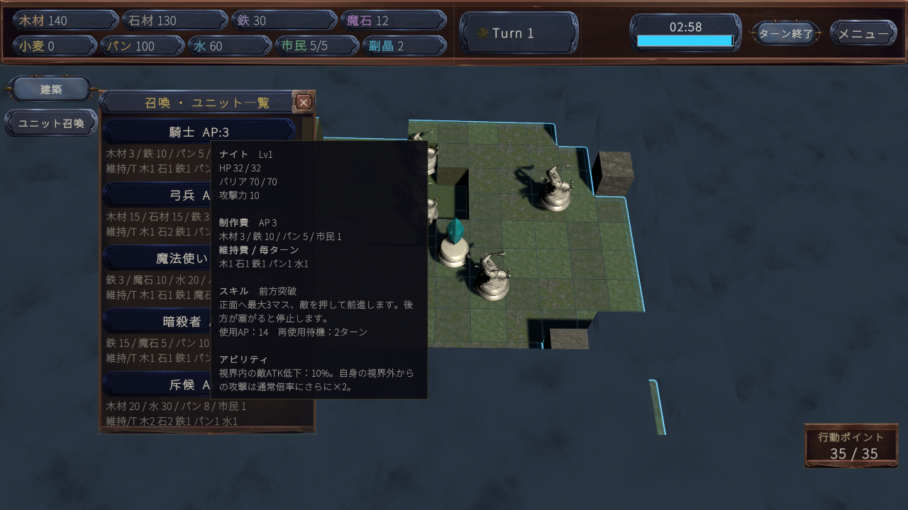

# Fantasy Kingdom — 実戦品質調査・修正結果

調査日：2026年10月22日〜23日。Unity 6000.3.8f1、既存 SampleScene と本番18職種データを使用した。

**実際にゲームを動かし、確認できた不具合を修正した。現時点で最大の未解決問題は、局地戦を続けても勝利対象の攻略に至らないこと。総合的なバランス調整完了とは判定しない。**

## 1. 実行した範囲

|区分|実際に実行したこと|ここからは判断できないこと|
|---|---|---|
|実戦AI対戦|本番シーンの「はじめから」を実行し、開発用プレイヤーAIを有効化。主評価5試合、合計840ラウンド。比較用2試合、400ラウンドも別記録|人間との対戦の勝率、初見の理解度、決着済み試合の所要時間|
|職種データ|本番の18職種×Lv1/10/50/100、72行を実行時に取得。HP、ATK、バリア、AP、制作費、維持費、スキル設定を記録|全レベルの実戦での適正価格|
|限定戦闘処理|通常ダメージ交換1,368ケース、9,618パケット。うち異レベル72ケース|射程、地形、移動、能動スキル、回復、編成を含む職種の総合勝率|
|実画面|本番ボタン・選択パネル・ホバーを実行。1280×720と960×600、最終22枚をUnityから描画|物理マウスの操作感、初見ユーザーテスト、密集した頭上表示の正確な配置|
|回帰検証|Unity Test Framework 11/11合格。加えて保護判定40、バリア74、AIバリア予測116などの専用検証を実行|全機能・全保存データ・全端末の不具合不存在|
|ビルド|Windows 64bit通常ビルド成功、ビルド報告のエラー0・警告0|配布ビルドを人間が最後まで操作したこと。Editor終了時には別途メモリ警告が残る|

AI対戦はコード上の盤面シミュレーションだけではない。実シーンの駒が移動し、攻撃・建築・召喚・維持費・視界更新・ターン交代を実行した。開始には本番Titleのコールバック、プレイヤーAIには既存の開発用機能を使用した。手動マウスプレイとは区別する。

実行はプロジェクトの隔離コピーで行い、検証専用の会社名・製品名で保存先を分離した。ユーザーの本番セーブ・学習記録・Recoveryシーンは検証用に上書きしていない。AP、資源、ターン制限、timeScale、AI思考予算を対戦のために増減していない。報告用に全体HPを観測した情報はAIへ渡していない。

## 2. 総合評価

P1＝ゲーム進行・公平性・勝敗に関わる優先事項、P2＝品質・調整の優先事項。評価はこの実行範囲に限る。

|項目|評価|問題点|改善優先度|
|---|---|---|---|
|AIの戦闘判断|一部修正済み、長期目標は要改善|無敵の野生強敵への連射を解消。局地戦から王・メインクリスタル攻略へつながらない|P1|
|AIの経済判断|改善を確認|必須施設の建築資金を他用途へ使う問題を修正。終盤の投資停止・余剰活用は要検証|P2|
|職種バランス|部分検証|18職種を比較。竜騎士の実戦スキルを両軍で確認。重戦士の実戦使用0、編成・射程・回復を含む相性は未検証|P1調査／P2調整|
|経済バランス|序盤改善、後半に余剰|鉄供給の立上がりが改善。長期戦で木・石・水が蓄積。破綻後の実戦復帰は未検証|P2|
|UIの視認性|確認範囲で改善|初回ツールチップの枠不足、説明書の小さい文字とスクロールを修正。密集した頭上表示は未検証|P2|
|UIの理解しやすさ|表示整理済み、初見評価は未検証|スキル名重複を除去し、勝敗説明を訂正。維持/Tの初見理解、呼称の揺れは確認余地|P2|
|ゲームテンポ|要改善|主評価5/5試合が120〜200ラウンドで未決着。王・メインクリスタルへの攻撃0|P1|
|総合完成度|継続改善が必要|ターン進行と通常戦闘は動作。決着への作戦、長期経済、未検証条件が残る|P1|

## 3. 実戦記録

1ラウンドは両軍それぞれの1ターン。上限中断は敗北・勝利・正式な引分に数えない。敵脅威度とプレイヤー開発AIの知能は別設定で、後者は15に固定した。各試合の探索は時間予算を持つため、同じ乱数シードでもフレーム進行により経路が完全一致するとは限らない。

|試合|地形シード|敵の初期脅威度／人格|ラウンド|通常攻撃 P/E|勝利対象攻撃 P/E|結果|
|---|---:|---|---:|---:|---:|---|
|A：資金予約修正後|161803|15 / Adaptive|200|522 / 478|0 / 0|上限で未決着|
|B：資金予約修正後|271828|15 / Intellect|200|258 / 74|0 / 0|上限で未決着|
|C：追加難易度|424242|1 / Combat|120|32 / 37|0 / 0|上限で未決着|
|D：追加難易度|424242|30 / Combat|120|164 / 122|0 / 0|上限で未決着|
|E：保護対象修正後の再戦|271828|15 / Intellect|200|452 / 455|0 / 0|上限で未決着|

5試合とも実行エラー・例外・アサート0。別途、資金予約修正前にA/Bと同じシードで各200ラウンドを実行した。**異なる改修版の試合を混ぜた勝率比較はしていない。**

原本から保存した[試合一覧CSV](Validation/QualityAudit_20261023/match-summary.csv)、[各試合の生データ](Validation/QualityAudit_20261023/evidence-manifest.json)。各フォルダの `match.json` は集計、`turns.csv` は資源・軍数などのターン境界、`actions.csv` は行動記録である。

実際の試合E・120ラウンド。これはUIモックではなく、実際に建築・育成・探索が進んだ盤面。

### AIの個別項目

|調査項目|実戦または実行で確認したこと|未検証・注意点|
|---|---|---|
|無意味な反復|Bの野生Bossへの0ダメージ通常攻撃148回を確認し修正。Eでは同種0回|Eにも往復移動の検出9/0があり、反復一般を全廃したとは言えない|
|攻撃対象の無視|通常戦闘は両軍で多数実行|合法攻撃候補全件と見送り理由を保存しておらず、全機会の妥当性は未検証|
|探索・視界|Aで開いたマスは1014/948、Bで865/776。領土外への探索は発生|地形・高低差の利用が有利だったかという対照比較は未検証|
|連携|Aで援護67/48、包囲70/124の実行記録|単独行動より損失を抑えたかは未検証|
|撤退|Aで69/60、Bで101/102の撤退記録|撤退の実行を救命率や適切な再編の証明にはしない|
|HP・バリア|バリアだけを削る攻撃、HPへの超過、竜騎士の貫通を実戦確認。予測の回帰試験も実行|全候補に対する最適な攻撃順は未検証|
|建築・生産|Aで建築78/73、召喚92/97。Eで75/62、99/90|建築の多さだけで経済効率が良いとは判定しない|
|不足の予測|必須供給施設の資金予約修正で採掘場の立上がりが早まった|個々の候補理由は未記録。予測による選択か結果だけから断定しない|
|難易度|同じシード・人格で脅威度1と30を実行。30では交戦・撃破が増えた|各1試合・未決着なので適正勝率や難易度曲線は未検証|
|非公開情報|野生強敵の保護予測から全陣営Registry参照を除去。隠れた侵入者を動かす両陣営テスト合格|全AIのあらゆる情報経路が公平と証明したわけではない|

### 試合の段階別評価

- **序盤**：基礎生産を準備し、探索を開始することは確認できた。「初めての人が何をすべきか分かるか」は人による検証がないため未判定。
- **中盤**：生産拡張、編成拡大、交戦、援護・包囲・撤退が発生。単なる移動だけではない。ただし選択肢の面白さは自動対戦だけで確定しない。
- **終盤**：200ラウンドでも両軍が存続し、勝利対象への攻撃0。膠着の問題が残る。
- **劣勢時**：撃破後の補充・撤退は発生。補給網を失った状態から逆転する実戦シナリオは未検証。
- **優勢時**：主力を維持しても勝利対象の攻略に進まない。人の操作が単純作業になるかは未検証だが、決着へ向かう手段の評価が優先。

## 4. 問題ごとの記録と対応

### P1-01：勝利対象へ攻撃が届かず、長期戦が続く【未解決】

- **問題**：A〜Eすべて未決着、両軍の王・メインクリスタルへの攻撃0。Eでも通常攻撃907回、撃破133体、サブクリスタルへの攻撃25回はある。ターン停止ではなく、局地戦から勝利行動へつながらない。
- **証拠**：[Eの集計](Validation/QualityAudit_20261023/matches/protected-retest/01-271828/match.json)、同フォルダの `turns.csv` / `actions.csv`、A〜Dの同項目。Eの王HP375は成長を含み、被ダメージの記録ではない。
- **再現手順**：本番SampleSceneで新規開始、記録の地形シード・敵シード・人格・脅威度を指定し開発AIを有効化。200ラウンドまで進める。C/Dは120ラウンド。
- **発生頻度**：主評価5/5で上限未決着、勝利対象攻撃0。特定の原因の発生率は未測定。
- **原因の推定**：拠点周辺7×7の現在視界、情報の鮮度、既知経路、集合・必要戦力の条件が作戦継続を妨げる可能性。未発見のままなのか、経路がないのか、戦術候補へ負けるのかは今回の記録だけでは特定できない。バリア回復やクリスタルHPが直接原因とも断定しない。
- **具体的な改善方法**：作戦の対象ID・段階・発見状態・経路・集合率・却下理由、可視の勝利対象への合法攻撃候補数をターンごとに記録する。頻発する停止理由を直し、同条件で決着まで再検証する。固定拠点の位置記憶と周囲防衛情報の鮮度を分ける案を比較する。
- **副作用の可能性**：条件を一律に緩めるとFogの価値と王の安全性が下がる。全軍強制突撃、敵位置の不正参照、根拠のないHP削減では解決しない。

### P1-02：無敵の野生強敵へAPを使い続ける【修正・同条件再戦済み】

- **問題**：BのPlayerは通常攻撃258回中148回が野生Bossへの0ダメージ攻撃。同じ位置から1ターン7回の反復があった。
- **証拠**：[修正前B actions.csv](Validation/QualityAudit_20261023/matches/capital-after/02-271828/actions.csv) のCSV行1074以降、[修正後E actions.csv](Validation/QualityAudit_20261023/matches/protected-retest/01-271828/actions.csv)。勝利対象のBossではなく、野生強敵であることもフラグで確認。
- **再現手順**：強敵縄張り内に解除条件となる駒がいない状態で、縄張り外から射程に入れる。上記シードの自然進行でも確認した。
- **発生頻度**：修正前2試合のうちBで顕著。修正後の同シード200ラウンドでは当該0ダメージ攻撃148→0回。解除後のBossへの通常攻撃17回は残っており、Boss攻撃自体の禁止ではない。
- **原因**：ダメージ0でも基礎攻撃点があり、予測と候補生成が縄張り無敵を十分に扱っていなかった。
- **修正**：自軍・観測済みの駒から解除を確認できない継続保護対象への通常攻撃と即時の純粋ダメージ技を除外。有限バリアを削る行動、単発無効の消費、有効な状態異常・支援・準備行動は維持。シミュレーションの複製・ハッシュにも保護状態を保持。
- **副作用**：見えない他軍が解除した場合でも、AIは観測するまで攻撃を控える場合がある。公平な情報制限に伴う保守的判断。
- **再検証**：保護対象40チェック合格、同条件実戦E。王・クリスタル攻略の膠着はこれだけでは解消しなかった。

### P1-03：保護予測がFog外の駒を参照し得る【修正・制御試験済み】

- **問題と証拠区分**：AIの保護予測が実世界の全陣営Registryを使い、見えない縄張り侵入者に影響されるコード経路を確認。対戦CSVだけから情報漏洩の発生回数を実測したわけではない。
- **再現手順**：AI観測盤面を固定し、不可視の相手だけを強敵縄張りの内外へ移し、予測結果を比較する。
- **発生頻度**：条件付き。実戦回数は未測定。両陣営の制御試験は実行。
- **原因・修正**：AI用判定を当該観測盤面へ限定し、実際のゲームルール・UIが知る保護状態とAIが推定できる保護状態を分離した。
- **証拠**：`Tests~/ProtectedTargetAITests.cs` と[検証要約](Validation/QualityAudit_20261023/tests/validation-summary.txt)。隠れた駒だけを変更しても予測不変、HP/AP不変、有限バリア・単発無効・状態異常の意味を保持する試験に合格。
- **副作用**：P1-02と同じ保守的判断。全AIの非公開情報参照がないことを一度に証明するものではない。

### P1-04：不足している必須生産施設の建築資金を先に使う【修正・前後比較済み】

- **問題**：鉄を生産する採掘場の石45を確保する前に、他の基礎施設へ資金を回し、供給開始と維持費回復が遅れた。
- **証拠**：同シードの[資金予約修正前](Validation/QualityAudit_20261023/matches/capital-before/)と[修正後](Validation/QualityAudit_20261023/matches/capital-after/)の `actions.csv` / `turns.csv`。採掘場の初建設ラウンド23→13、最大連続未払い9→2を確認。
- **再現手順**：A/Bの新規開始条件で、既存生産・維持費を保ったまま基礎施設を選ぶ。比較は施設価格や生産量の変更ではない。
- **発生頻度**：修正前の同2シードの序盤で遅延。修正後も短い未払いは残り、完全な無不足は主張しない。
- **原因**：基礎生産への支出で資金予約を広く緩め、より切迫した未設置の必須供給施設の原資まで使えた。
- **修正**：最も早く不足する必須生産施設1つの実費を予約。建つまでの確定純生産を考慮し、緊急の補給修理・防衛は妨げない。別の計画へ切り替えたときに予約キャッシュを破棄する。
- **副作用**：別の建築が遅れる場合がある。全施設分を一度に過剰予約せず1つに限定し、確率ボーナスを確実な収入として当て込まない。
- **再検証**：実戦の前後比較と、両陣営の実取引・建設・以後の維持費を確認する回帰試験。最後の2ターン分は水入力を含む供給の立上がりも関係し、原因を同一視しない。

### P2-01：バリア等の複数回ダメージ予測の不整合【修正・制御試験済み】

- **問題**：複数のダメージを予測すると、1回無効や一時効果を毎回再利用する場合があった。有限バリア、生命接続相手の死亡、反撃・環境・反動の累積も誤判断につながる。
- **証拠区分**：実戦で個々の誤選択をすべて追跡したものではない。実ゲーム処理と照合する制御ランタイム試験で確認。
- **再現手順**：1回無効＋連続毒ダメージ、有限バリアの連続消費、生命接続相手が途中で倒れる、聖騎士の回復中断などを両視点で予測し、実処理と比較する。
- **頻度**：制御ケースに依存。実戦発生率は未測定。
- **原因・修正**：観測済み状態を小さな値型のダメージ予算へ捕捉し、パケットごとに消費して同じ無効化を使い回さない。隠れた支援者や相手の非公開視界を読み込まない。実際のバリア、単発無効、HP代償、通常反動のルールを混同しない。
- **副作用**：生命接続の予測は観測済みの限定された接続関係を対象とし、未観測の可能性まで完全再現するものではない。
- **再検証**：AIバリア関連116チェック合格。実戦でHP損失とバリア損失を別計測した。

### P2-02：長期戦で基礎資源が余る【調整前の要検証事項】

- **問題**：A終盤のPlayer木/石/水は350/350/350、Bの水は475で容量上限。後半の余剰を確認した。
- **証拠**：A/Bの `turns.csv`。ターン境界の値であり支払直後の瞬間的最低値ではない。[AI・経済詳細](Validation/QualityAudit_20261023/ai-economy-findings.md)に序盤・終盤の比較表。
- **再現・頻度**：A/Bの4国家の後半で水や基礎資源が蓄積。全資源が常に余るわけではなく、鉄・パン等の推移は異なる。
- **原因の推定**：200ラウンド続く生産と、建築・軍の更新・決着の停滞が重なっている可能性。生産量単独が過大という対照結果はない。水は畑・パン加工・軍維持でも必要。
- **改善方法**：まず決着作戦を修正し、通常の試合長で過不足を再測定する。次に予測純収支と支出予定に基づく建築停止・軍更新・備蓄目標を比較する。必要なら特定レシピを個別調整する。
- **副作用**：維持費の一律増加は序盤の不足と復帰困難を悪化させるため、今回勝手に上げていない。

### P2-03：重戦士専用技の実戦使用0【原因未確定】

- **問題**：Eでは重戦士12個体を観測したが専用技0。竜騎士は28個体、貫通2回。
- **証拠**：[E match.json](Validation/QualityAudit_20261023/matches/protected-retest/01-271828/match.json)。竜騎士は同 `actions.csv` CSV行2112（Playerラウンド110、16HPダメージ・撃破1）、2813（Enemyラウンド137、21HPダメージ・撃破1）。
- **再現・頻度**：Eの200ラウンドで重戦士0。全18職種のスキル有効フラグはtrue、設定エラー空欄。無効化が原因と断定しない。
- **原因の推定**：重戦士の専用技14APと通常2APの機会費用、対象のバリア量、接近、残AP、評価の差が候補。合法な使用機会自体を数えていない。
- **改善方法**：見えている高バリア目標に隣接しAP14以上を持つ少人数シナリオを実行し、候補数・却下理由・選択を通常攻撃と比較する。
- **副作用**：専用技への固定加点は通常攻撃で倒せる敵への無駄打ちを増やす。使用回数を増やすこと自体を目的にしない。

### P2-04：Guardian等の初期耐久・人口・価格差【バグと未判定】

- **観測データ**：ガーディアンLv1はHP42＋バリア15＝57、ナイトは32＋70＝102。Lv10では210対174へ逆転。航海士とガーディアンは石50・魔30・水50・AP10・市民0という同一制作費を持つ。
- **証拠・頻度**：[本番72行](Validation/QualityAudit_20261023/verified-ui/roles/roles.csv)。固定データの差であり、発生率を数える不具合ではない。
- **再現**：本番データを読み、Lv1/10のHP・バリア・レシピを比較する。これは実戦での弱さ・上位互換を確認した手順ではない。
- **原因の推定**：職種別HP/ATK成長、共通バリア成長、生命接続・正面攻撃・引寄せという役割の違い。市民0が意図した仕様かは未確定。
- **改善方法**：生命接続・割合回復・直接HP代償を含むLv1/10の等予算編成で、救命率・接敵・継戦能力を比較してから判断する。
- **副作用**：HPや人口コストを一律に変えると生命接続・割合回復・既存国家の召喚可能数まで変わる。今回数値は変更していない。

### P2-05：Editor終了時のJobTempAlloc警告【未解消・発生元を絞り込み】

- **問題**：通常Windowsビルドは成功したが、Editor終了時に `There are remaining Allocations on the JobTempAlloc` が残る。
- **証拠**：検証ログ要約、[診断要約JSON](Validation/QualityAudit_20261023/jobtemp-diagnostic-summary.json)。診断フラグで再ビルドしたログも保存した。採取した割当スタックはいずれもUnityネイティブの `ShaderCompilation::CompileVariantJob` を含む。同じ割当の再出力もあるため、スタック行数を固有リーク数として数えない。
- **再現**：隔離プロジェクトで `ReleaseValidation.RunGraceful` を実行し、ビルド後3秒Editor更新を経て終了。診断時は `-diag-job-temp-memory-leak-validation` を付加。
- **頻度**：最終通常ビルドと診断ビルドの両方で確認。警告回数は診断による再出力も含む。
- **原因の推定**：この記録のスタックはビルドのシェーダーコンパイル系。AIの配列・ゲーム中のバリア処理が直接漏らしている証拠はない。逆に、ゲーム中のリーク不存在も証明しない。
- **改善方法**：同じUnity版の最小シーン・シェーダー構成で切り分け、必要ならエンジン側再現資料にする。通常プレイはキャプチャなしのPlayer Profilerで別測定する。
- **副作用**：警告抑止や強制GCでは原因解消にならない。アセットを削って外観を変える対応はしていない。

実戦Eの記録はP95約10.03ms、最悪約845ms、割当メモリ約184→234MB。**Editorの処理・描画保存・モデルやフォントの初期化・軍数増加を含む**ため、通常操作の60fps、AI探索単独の停止時間、メモリリーク解消の保証には使わない。長時間連続の通常ビルドを使った性能試験は未検証。

## 5. UI：実画面で確認した修正

### 常時表示／選択時／詳細の整理

- 常時：既存の2段資源HUD、ターン・タイマー、APを維持。
- 選択時：名前、Lv、HP、その直下のバリア、ATK、操作ボタンを中心に表示。DEFは表示しない。自軍の実行可能スキル名を中央とボタンに二重表示しない。
- 詳細：能力の効果・条件・代償、制作費・維持費は詳細または召喚ホバーへ残す。情報そのものを消して文字数を減らす対応はしていない。

|問題|証拠・再現・頻度|修正と実画面での再確認|副作用・残る点|
|---|---|---|---|
|説明書が小さい／本文高が内容と不整合|メニュー→説明書→駒。修正前2/2解像度。960で本文約8.43px、105行の希望高さと実矩形が不整合|本文26論理px、内容高に従うLayoutとスクロールバー。960で約13.70pxへ。ルール最終の「固定スキル」まで実際にスクロールして確認|1画面の行数が減る。初見の読む速さは未測定|
|説明書だけ独自の緑・灰色ボタン|説明書を開く。2/2解像度|共通テーマと読みやすいラベル、横幅を使う閉じるボタンへ|テーマ変更に追従。クリック数は同じ|
|スキル名の重複|騎士を選択。2/2解像度|中央の重複を省き、実行ボタンに名前とAPを維持|確認専用・敵表示は名称を残す。全職種の画面巡回は未実施|
|維持費の「水」「1」が別行|召喚一覧の魔法使い。2/2解像度|長い接頭語を「維持/T」へ。水1が同じ行に収まることを確認|詳細では「毎ターン」と明記。略号の初見理解は未測定|
|能力詳細の文字が小さい|騎士選択→詳細。960で約11.60px|約13.70pxへ拡大。情報は既存スクロール内へ維持|スクロール量が増える|
|説明書の勝敗条件が古い|初回はコード照合、修正後はルール画面を実行|王またはメインクリスタルで勝敗、サブクリスタルは対象外と訂正。判定ルールは変更なし|常時HUDに条件帯を増設していない|
|最初の召喚ホバーだけ背景が小さい|冷状態1280の1/1で背景外へ本文が出た。再表示では正常|有効化後にTMPのメッシュと希望高さを更新。両解像度で冷状態・再表示とも背景549.28、本文521.28論理pxで一致、回帰2/2合格|初回表示時の同期レイアウト更新1回。毎フレームの走査は増やしていない|

各項目の原因、修正前後画像、再現手順は[UI詳細報告](Validation/QualityAudit_20261023/ui-findings.md)、実測は[UI記録JSON](Validation/QualityAudit_20261023/verified-ui/ui/ui-observations.json)。

修正後の冷状態・初回ホバー。制作費、維持費、スキル、アビリティを背景内に収めている。

**撮影方法の限界**：このUI監査はOverlay Canvasを一時的にカメラ描画へ変換する。頭上UIの座標更新と干渉し、一部の位置・不在を正しく評価できなかった。製品の頭上表示バグとも、密集時の最終配置合格とも報告しない。敵選択・既存建物の強化破壊画面も、開始時に合法的な対象がなかったため未検証。TMPのoverflow候補フラグも、画像で値が読める場合に不具合数として数えていない。

追加確認したいUI事項は、960で約10.54pxのホバー最長文、騎士／ナイト等の呼称の揺れ、維持/Tの理解、全18職種、敵・建物の選択、終盤の多桁数値、色覚差、物理マウス・ホイール、実ウィンドウのリサイズである。

## 6. 18職種と戦闘バランス

[全18職種のLv1制作費・維持費の完全表](Validation/QualityAudit_20261023/role-costs.md)、[72行の元データ](Validation/QualityAudit_20261023/verified-ui/roles/roles.csv)、[職種ごとの評価と制約](Validation/QualityAudit_20261023/role-findings.md)を保存した。

役割は維持して評価した。前衛のナイト、HP・生命接続のガーディアン、即時回復の白魔導士、回復領域で行動を止める聖騎士、視界と単発防護の斥候などを、通常攻撃の火力だけで同じ強さに揃えていない。

### 実処理で確認したこと

- 全18職種のスキル有効フラグtrue、設定エラーなし。
- バリアR1はDEFを使用せず、通常ダメージはバリアから消費し、超過だけHPへ届く。ダメージを無条件にHPへ最低1通す仕様へ変更していない。
- 低Lv先手の36ケースはすべて相手の有限バリアを削り、30ケースはHPにも届いた。低Lvが何も削れないわけではない。
- 異レベル72ケースはLv10生存66、Lv1生存6。ただし1軍が最大60APを連続使用する隣接通常交換で、射程・移動・反動・能動スキル・回復は除く。独立した実戦72試合の勝率ではない。
- 侍のゲージ通知・反撃は交換試験の生存結果に反映。残存バリア剥離等はバリアの専用回帰試験で確認。実戦での全反撃機会に対する選択妥当性は未測定。
- 竜騎士はEで両陣営が各1回、貫通スキルによる撃破まで実行した。通常攻撃のバリア無視へ変更していない。
- 重戦士の専用技は制御試験と有効設定を確認したが、主評価の自然な対戦では実行0。

### バランスの未確定部分

近距離対遠距離、回復支援込み、同じ資源・制作AP・維持費の編成、少数精鋭対大軍、Lv50/100軍の実戦は未検証。魔法狙撃手の自動反動を省いた通常交換成績を、そのまま総合順位にしていない。ガーディアンの生命接続、航海士の正面に立つ難しさ、ボマーの時限範囲技も通常交換だけでは測れない。

バリア回復を有効／無効にした同条件の実戦比較は未実施。長期戦の原因をバリア回復と決めて回復率を下げていない。重戦士・竜騎士の仮設定、暫定のダメージ式も、正式な最終バランス確定値とは扱わない。

## 7. 経済・国家運営

初動で畑、井戸、伐採、採石を建てる実行を確認した。資金予約修正後、最大連続未払い9→2へ改善し、A/Bとも最終的な飢餓・未払い・停止建物は0。通常の不足が一切発生しないという結果ではない。

生産施設には用途と入力がある。実データの例では伐採・採石は7、井戸は5を生産し、畑は水3→小麦3、パン屋は小麦3＋水3→パン3に加工する。水の需要を軍維持だけで見積もると不足する。確率で得る追加生産を確実な資金として予約しないようにした。

Lvが上がる軍には維持の代償がある。共通の鉄・水・パンはLv1各1、Lv10各2、Lv50各6、Lv100各11/ターン。木・石・魔鉱石は職種差もあるため完全表を参照。高Lv軍の維持可能規模と、補給網を失ってからの実戦復帰は未検証である。

**国家安定度・国家反乱は今回の現行実装で確認できなかったため評価対象外。** `RebelKnight` は野生強敵の種類であり、経済不満から起きる国家反乱を実装済みとみなしていない。

## 8. 検証ログと再現方法

- [Unity Test Framework結果](Validation/QualityAudit_20261023/tests/quality-r1-tests.xml)：11件合格、失敗・スキップ0。
- [専用検証とビルドの要約](Validation/QualityAudit_20261023/tests/validation-summary.txt)：保護40、バリア74、AIバリア116、既知拠点106、アサシン35、両陣営の実召喚288等。これは11件とは異なる内部チェック単位なので、同じ尺度で合算しない。
- Windows最終通常ビルド成功、ビルド報告エラー0・警告0。診断再ビルドも成功。前述の終了時JobTempAlloc警告は別に残る。
- `Tests~/QualityAuditSession.cs`：新規開始、本番UI呼出し、22画面、職種データ・限定戦闘処理の実行。
- `Tests~/AIClosingPlaytest.cs`：本番の開発AI対戦、シード・難易度・上限・出力先指定、行動・経済・戦況の記録。
- `Tests~/ProtectedTargetAITests.cs`：保護・観測情報の両陣営回帰。

これらは隔離した `UnityValidation` プロジェクト用ハーネスであり、本番シーンを検証用の盤面に書き換えて使うものではない。`Tests~` の検証コードを隔離コピーのEditor対象へ同期して実行する。試合の環境変数は `FK_CLOSING_SEEDS`、`FK_CLOSING_THREAT`、`FK_CLOSING_PERSONALITY`、`FK_CLOSING_OWNER_TURNS`、`FK_CLOSING_OUTPUT` などで、実行条件は保存済み `settings.json` と `run.json` に残した。

生のUnityログは作業ディレクトリに保持した。リポジトリにはライセンス・起動ログを丸ごと入れず、検証メッセージ要約、CSV/JSON、画像、XMLを収録した。保存ファイルと原本の対応・SHA-256は[証拠manifest](Validation/QualityAudit_20261023/evidence-manifest.json)に記録した。

## 9. 残る改善の順序

1. **勝利対象攻略の作戦停滞を特定・修正する。** 未発見／経路／視界／集合／候補評価を区別し、同条件の再戦で到達と決着を確認する。
2. **重戦士等の専用技の使用機会を計測する。** 機会なしと評価不良を分け、通常攻撃とのAP効率を保って直す。
3. **通常の試合長が確定してから経済を調整する。** 余剰と供給不足、復帰手段を分け、全資源の維持費を一律変更しない。
4. **等予算の編成実戦とUIの未検証状態を追加する。** 近遠距離、少数精鋭対大軍、補給喪失、敵・建物・密集UIを対象とする。
5. **通常ビルドの長時間Profiler測定とEditorメモリ警告の切分け。** この自動対戦のフレーム値だけで軽量化完了とは報告しない。

今回の「調査」は、根拠のある不具合の修正と再検証まで含めて進めた。未確定のゲーム数値・役割は勝手に変更せず、実測、制御試験、コードからの推定、未検証を分けて記録した。
