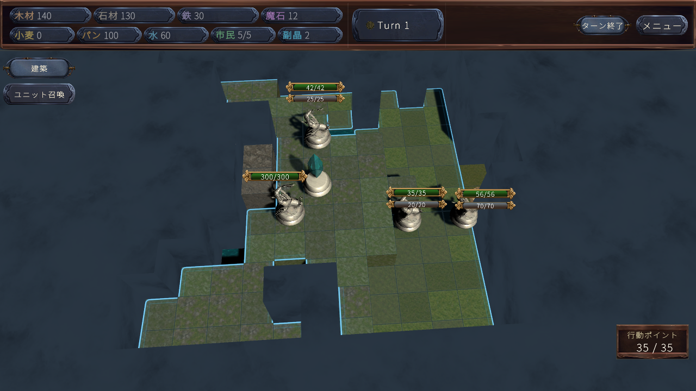
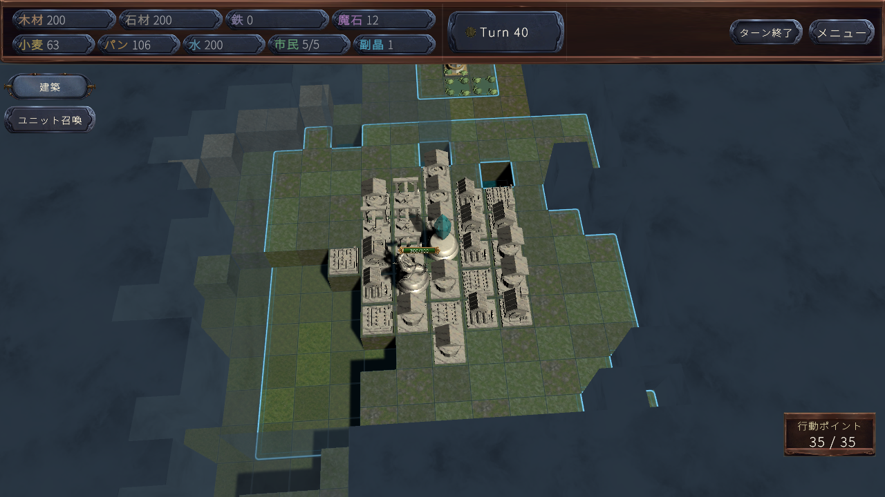

# R2 統合実装・実行結果（2026-10-30）

**現状はドラフトです。本番工兵データと総合バランス受入は未完です。** 通常兵の固定能力・固定維持費、バリア回復、未払いHP損失、時計の廃止、領土外採掘、工兵建築の正式コマンドを統合しました。Unityで実行した契約と、通常プレイで未達だった経済・決着を区別します。

## 入力と合意

- 対象仕様：`Fantasy_Kingdom_全変更統合_Codex実装仕様書_R2.md`。R1単独でなくR2後発条件を適用。
- 作業基点：`4897d5e9259cad1e5756526df50a914af729c43d`、ブランチ`codex/r2-fixed-units-engineers`。既存AI統合ブランチを継承。
- 作業開始時に確認したorigin/master：`0aec703dfa6648ed64eb5ae023374e3d5d407dd5`。
- ユーザー承認済み暫定値：未払いは最大HP20%・切上げ・バリア無視。工兵は資源のみ2倍、AP/市民通常。サブクリスタル対象外。
- 工兵の基礎能力、範囲、制作費、維持費はユーザーが具体値を指定する選択。**本番データを推測で登録していません。** 契約テスト内の数値は破棄する試験データです。
- 仕様の40×40という前提と、実際の35×35が不一致です。変更禁止に従い地形生成・シーン・Prefab・マップ寸法を変更していません。40×40指定受入はFAIL（前提不一致）。

## 実装と理由

| 領域 | 主なファイル | 変更理由・結果 |
|---|---|---|
| 通常兵能力 | `FixedUnitRules.cs`, `UnitData.cs`, `Status.cs`, `StatusBalanceRefresh.cs` | 未加工定義を保持しHP/ATK/DEFを7/4倍、半端切上げ、整数飽和。個体Lv1/XP0、再計算で再乗算しない。報酬差分・HP比率・状態効果を保持。王/ボス専用能力と施設Lvは別扱い。 |
| 維持費と未払い | `EconomySystem.cs`, `FactionState.cs`, `R2EconomyRules.cs` | 旧Lv1維持費と設定追加分の全資源を5倍。免除は維持。自軍ターン一度だけ未払いHP損失を適用し旧能力低下/離脱を置換。通常死亡処理へ接続。 |
| バリア | `BarrierSystem.cs`, `Status.Barrier.cs`, `SimBoardState.Turn.cs` | HP最大到達から3回の自軍境界後に20%再生。HP損失で待機をやり直し、バリアだけの損失で待機を消さない。古い時計は保守的に移行。 |
| 時計と表示 | `TimerSystem.cs`, `TopBarUI.cs`, `UnitHeadUI.cs`, `UnitPanelUI.cs`, `SummonUnitTooltip.cs`, 開発スタジオ | 対局/ターン時計と時間切れ勝敗を無効化。通常兵Lv/XP表示を除去し、施設強化、HP/バリア、費用、維持費を残す。AI技術探索予算は有界。 |
| 領土外採掘 | `FacilityData.TerritoryProduction.cs`, `BuildValidator.cs`, `AIConstructionEconomy.cs` | 所属陣営の自領土内では鉄/魔石の産出だけを0にする。外の配合・確率と他資源を維持。既存施設を消さず、領土変化を実値/予測/UIへ反映。初期資源と晶の支援は維持。 |
| 工兵正式建築 | `BuildSystem.Engineer.cs`, `BuildSummonUIBuilder.Engineer.cs` | 本人の公式3D視界、敵領土禁止、施設制約、費用、APを再検証。失敗時無課金・ロールバック。所有権/工兵由来を保存し領土を生成しない。未視認領土を失敗文言で漏らさない。 |
| AIとSim | `AIActionGenerator.Engineer.cs`, `StrategicEconomyForecast.cs`, `StrategicProductionDemand.cs`, governor, Sim群 | 候補数上限、同じ建築/採掘/支払関数、位置別予測、未払いHP/死亡予測へ接続。既存兵の未払いを理由に復旧工兵まで拒絶する循環を修正。普通兵の制限は残し、追加損失/新しい資源障害を生まない工兵だけ許可。 |
| セーブ | `SaveSystem.R2Migration.cs`, collect/validation/data, `SaveGameApplier.cs`, `AICommander.CognitionSave.cs` | V11→V12を末尾追加。判別できる旧成長のみ変換し恒久補正と死亡を保持。不明基礎は元能力と証拠を保存して保留し、実際の定義確定後に解決。未来版拒否と二重変換防止。AIの任意状態がJSONで空オブジェクト化される経路は完全な既定空形だけを欠損扱いにし、別陣営・別対局・未来版・内容付き不正データは引き続き拒否。 |

全変更パスは[changed-source-files.json](Validation/R2_20261029/changed-source-files.json)。旧成長参照の前後監査を保存しています。残る参照は互換ラッパー、旧保存読取、施設Lv、AI脅威度、AIの経験学習、歴史的テスト等を分けて扱い、一括削除していません。

## 実行した検証

実行環境：Unity6000.3.8f1、分離プロジェクト`UnityValidation`。Editorネイティブ起動と実際のPlay Modeを使用し、Roslynのみで「プレイ済み」としていません。Unity Test FrameworkのXMLではなく、既存方式の例外付き契約ハーネスです。

- RoslynのRuntime/Editor/Release3構成：各終了コード0。497/213/497ソース。
- `R2CoreContracts.Run`：固定値、維持費、移行、バリアBR01–12、時計/UI27チェック。ネイティブ完了。
- `R2ConstructionEconomyTests`：Play Mode68チェック。Player/Enemy両側、正式支払い、個別視界/共有視界、敵領土、失敗ロールバック、未払い死亡/重複処理を確認。
- `R2EngineerAIContracts`：Play Mode。実際のAI建築コマンド、費用/採掘/未払い予測の一致、および復旧工兵のFilter/実行ゲートと通常兵・高維持費・資源/AP/市民不足の拒否を検証。
- 既存回帰：`CoreLogicTests.RunAll`と`AIR3PreservationTests`のネイティブ実行ログを添付。R2と衝突していたXP/維持費/ゲーム時計の期待値は新ルールへ更新。回復兵の資源予備判定は新維持費を払える試験在庫にし、晶の割合HP反撃テストは初期バリアを空にして目的を分離（本番反撃のバリア優先は維持）。
- 旧保存コピー3件：V11→V12、28/31/28個体、変換保留0、35×35。保存→再読込で状態一致。原本は読取専用コピーを作り、書込みはテスト用一時保存先のみ。ユーザー保存本体はコミットしていません。
- 旧保存検証の最初の起動はコピー先環境変数不足で未実行。その後、指定して3件成功。最初の起動失敗をゲームの移行障害にも、成功件数にも計上していません。

契約ログ抜粋と元ログSHA256は[native-evidence-index.json](Validation/R2_20261029/native-evidence-index.json)。旧R1の70%バリア/レベル維持費/離脱を前提とする歴史的ハーネスは新受入の代用にしていません。

## 通常自動対戦の実測

通常SampleSceneの「はじめから」後、開発者PlayerAI15とEnemy脅威度15で2シード。timeScale1、AP/在庫/探索予算/地形を試験用に増減していません。各40ラウンド・80自軍ターン境界、合計160境界を観測して停止。勝利完走ではありません。

| シード | ラウンド | 攻撃 Player/Enemy | 新規召喚 Player/Enemy | 最終鉄 Player/Enemy | Error/Exception/Assertion | 結果 |
|---|---:|---:|---:|---:|---|---|
| 161803 | 40 | 0/3 | 0/0 | 0/0 | 0/0/0 | 未決着・観測上限 |
| 271828 | 40 | 0/0 | 0/0 | 0/0 | 0/0/0 | 未決着・観測上限 |

両軍の工兵本番設定はfalseです。鉄が尽きても領土外採掘へ移れず軍の追加生産がありません。片方の試合では敵の通常攻撃が3回発生しました。「全試合で攻撃0」とは報告しません。これは本番経済の受入不合格であり、木石水の生産や建築が進むことだけでバランス良好とは評価しません。

技術進行エラー0でも、決着・18職種比較・採掘再建の通常対戦は未受入です。補給工兵の試験定義による個別PASSは、本番未登録の解消を意味しません。

観測コードの入力SHA：`5c8d90a604b79db30cbe0e3b3acf81bf8e0ecd4c8cd8b329de1a060ccf8580b0`。ゲーム資産SHA：`fe434f82ea69ac044e842d85bc8eebbb41eef07ba3235c8ebeaa77eeedb73d82`。実行前の全入力一覧は[autoplay-input-manifest.json](Validation/R2_20261029/autoplay-input-manifest.json)、戦況/経済/正式行動記録を同ディレクトリに保存。

性能値はEditorの短期2試合の参考値だけです。p95フレームは5.51/5.57ms、最長フレームは1367.6/1190.7ms。初期化・読込を含み、CPU/GPUプロファイラで原因分解していません。長期メモリ安定やフリーズ解消を証明しません。ビルドEXEの起動検証も未実施です。

## 画面確認

実キャプチャで、Lvメダルと時計の除去、HPの下のバリア、資源/AP表示を確認しました。下図は試験用UIモックではありません。40ラウンド画像では建物の密集が駒を見づらくする点も残ります。全解像度/全パネル/入力装置/18職種の見やすさは未検証です。

## 166項目の受入状況

{'PASS': 76, 'NOT RUN': 85, 'FAIL': 5}。台帳は[acceptance-ledger.json](Validation/R2_20261029/acceptance-ledger.json)。部分確認を要件全体のPASSに拡大していません。NOT RUNは部分確認を含み、FAILは既知の本番前提未達も含みます。

## 次に必要な作業

1. ユーザー指定の工兵基礎HP/ATK/バリア、移動/攻撃/視界、制作費/AP/市民、基本維持費を本番登録する。倍率適用前の値が必要です。
2. 指定後、序盤資源から工兵生産→現地派遣→領土外鉱山→維持費支払と増兵まで通常対戦で確認し、脅威度/シード/長短期を広げる。
3. 未実行の旧保存全世代・工兵保存復帰・視界/領土変更中の建築・全施設/全UI・18職種/勝敗完走を台帳順に検証する。
4. 35×35と40×40の前提不一致は仕様側の確認が必要。今回のパッチでマップを改変して解消しない。

本番の必須データが欠けた状態なので、ドラフトを完成済み・バランス調整済みとは扱いません。
