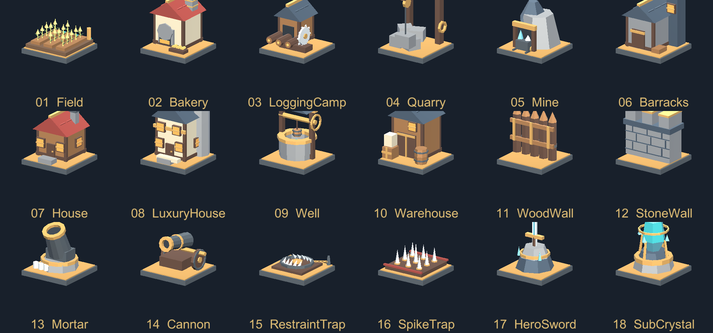
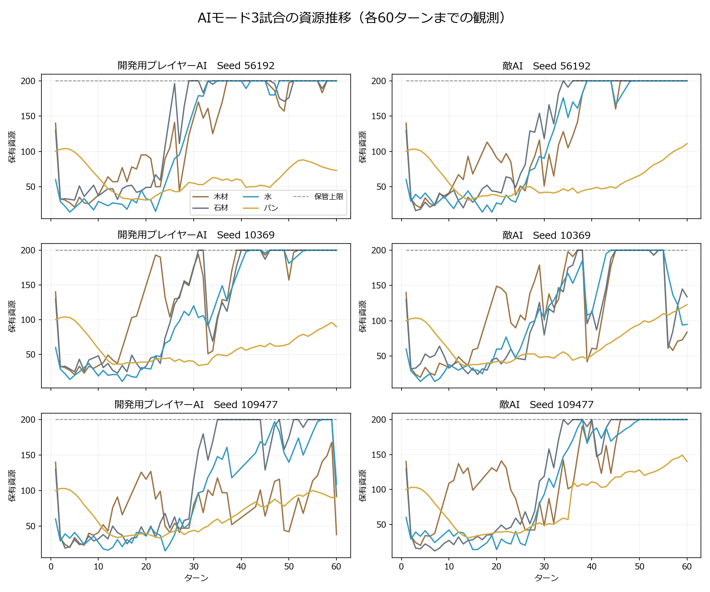
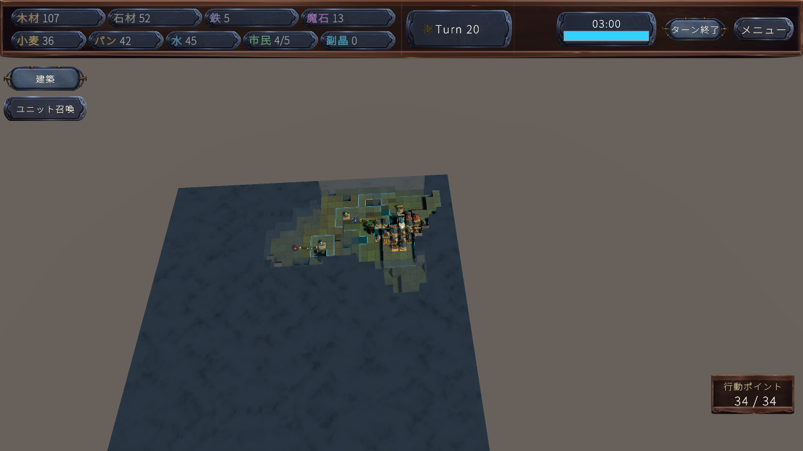

# 開発スタジオ・資源バランス・建物・AIの整備（2026-10-12）

開発スタジオの設定を、実際のゲーム計算・UI・AI予測の共通データへ反映するよう整えました。作成した駒・建物・行動マスの設定は登録解除と復元ができます。全18種類の標準建物へ外観を追加し、レベル差の大きい相手にも有効な命中攻撃で最低1ダメージが入るよう統一しました。

## Unityで操作する場所

`Fantasy Kingdom → 開発スタジオ（日本語）` を開きます。

- **駒づくり／建物づくり**：対象を選び、「登録解除して削除（復元可能）」でゲームと一覧から除外します。「削除・保管した設定を表示」から復元できます。Ctrl+Z／やり直しにも対応します。
- **行動マスの設定**：割り当て解除、共有されていない設定の削除、保管した設定の再割り当てができます。
- **陣営・ゲームルール → 戦闘**：「命中した攻撃の最低ダメージ」を編集します。現在は1です。
- **陣営・ゲームルール → 維持・経済**：保管上限、序盤支援、軍の追加維持費、生産量を編集します。
- 設定を編集したら **「すべて保存」** を押して、新規ゲームで初期資材・マップ・時間設定を確認します。標準建物の編集用複製を反映する場合は **「この設定を標準建物へ反映（重複追加しない）」** を使います。

削除は登録解除です。共有PrefabやMaterialのファイル、古いセーブが参照する保存用IDは保持します。別の設定・第三陣営・開いているシーンが使っている設定は、使用箇所を示して参照を外すよう案内します。復元するときも新しい標準設定を上書きしません。

## 今回の資源調整

| 項目 | 現在の設定 |
|---|---|
| 両陣営の初期資材 | 木140、石130、水60、鉄30、魔石12、パン100、市民5 |
| クリスタルの序盤支援 | 木12、石10、水6、鉄2、パン12を基準に6ターンで減衰・終了 |
| 通常軍の追加維持費 | 木1・石1・水1／駒。王・免除駒は対象外。既存の鉄・パン維持費に加算 |
| 基本保管上限 | 各資源200＋倉庫の増加量。市民は住宅による別の上限 |
| 伐採所／採石場の建築時の水 | 各15 |
| 鉱山の建築費 | 木45・石45・水20・市民2・AP7 |

倉庫を建てていない間に保管上限が無効になる挙動を修正しました。ゲームルールで上限適用を有効にしています。支援・維持費・保管上限は実際の経済処理とAI予測が同じデータを使います。既存の生産データを別の固定値で上書きする方式は追加していません。

初期資材は新規ゲームで適用します。共通の維持費・最低ダメージ・保管ルールは読み込んだゲームにも適用されます。保管上限を超えた資材は次の経済処理で上限に収まります。従来の保管方式を使う場合はスタジオの「倉庫がなくても資源の保管上限を適用」を無効にします。

## ダメージ

基礎計算だけで最低値を適用しても、後から防御補正・バリア・スキル倍率を掛けると丸めで0になる経路がありました。共有の最終確定処理へ最低値を集約しました。通常攻撃・攻撃スキル・連撃・砲撃・AI簡易予測・Minimax実行が同じ最低値を使います。

シールド、攻撃不能、強敵の領域無敵、完全に相殺されたスキル、回復・支援、死亡済み対象は従来の意味を維持します。非常に大きい数値も整数の桁あふれで0へ戻りません。

## 建物の外観

全18種類を木・石・真鍮・青緑の結晶で統一しました。各建物はRenderer 1個、共有Material 1個、BoxCollider 1個です。全種類合計8304三角形、最大708三角形／種類で、16×16の色パレットを使用します。モデルはEditorで保存し、プレイ中に部品を生成する処理はありません。

標準Prefabは `Assets/Prefabs/Facilities`、制作スタジオの既存モデルは `Assets/_FantasyKingdom/GameContent/Buildings/既存の建物データ`、共有モデルは `Assets/_FantasyKingdom/Art/Buildings` です。地面との接地・1マスのクリック判定・保存座標の維持を検証しています。

建物を生成できなかった場合にAP・資源が引かれたり、成功イベントが出たりする問題も修正しました。正常なPrefabは一度だけ費用を支払い、壊れたPrefabでは支払わず失敗を返します。

## スタジオ反映・住宅・拠点作戦

正式な駒・建物の費用、能力、生産、維持費、行動マス、使用陣営を実ゲームとAIの参照へ反映します。既存の駒への能力変更ではHP割合と獲得済み成長・報酬を保持します。建築・強化・解体直後にも収容数を更新します。

住宅投資は、市民の手持ち不足と収容上限不足を分けて判断します。今の容量で補充を待てる場合は住宅を乱立させません。計画する建築と作戦部隊の実際の市民費、生産維持、安全な防衛兵の補充可能性を見ます。実行ログには支払い前の採用理由を保持します。

拠点作戦は既存Operation Managerへ統合しました。視認・過去の合法的な発見だけから敵拠点の価値、防衛情報の確実性、戦力、経済状態を評価します。必要な偵察、集合、複数の進入路、陽動、攻撃、襲撃後の撤退を扱います。未発見の拠点やFog内の現在HPを読む処理はありません。保存には試合中の情報と試合間学習を分離します。

## 検証

総合の `SceneSmoke` が全項目を通過しました。今回追加・強化した主な検証は以下です。

| 対象 | 通過した検証 |
|---|---:|
| 削除・参照・Undo・復元・旧ID | 44 |
| スタジオ登録・キャッシュ更新 | 32 |
| 実UI・取引・生産・予測・能力反映 | 49 |
| 住宅投資・上限・実行理由 | 50 |
| 既知拠点・作戦・Fog・保存 | 88 |
| シミュレーションの正式データ | 15 |
| 資源収支・保管・大きい市民数 | 19 |
| 建物の外観・接地・当たり判定 | 581 |
| 実Prefabの生成失敗と支払い | 43 |
| Lv1対Lv100・特殊無効化・最低ダメージ | 31 |
| 攻撃候補の旧実装との一致 | 747 |

PlayerProfilerは2万観測・200回更新について、旧実装と55項目を誤差許容なしで比較します。履歴を毎回全走査する更新を集計の再利用に変更しました。攻撃候補も占有データを再利用し、同じ169体・1075マス・200照会の検証で3094.308msから32.508msでした。これはその処理だけのEditor測定です。

通常のAP操作と副晶返却の診断ログ7箇所も、詳細ログが無効なら文字列を作らない形へ変更しました。ゲーム内の戦闘表示、日記、学習、警告・エラーは維持します。

## AIモードで3回プレイした結果

通常の `Player → Enemy → 第三陣営` のターン進行と、開発用プレイヤーAIを使用しました。敵の脅威度も15へ設定し、思考時間・候補数・AP・資源をテストのために増やしていません。マップの乱数は56192・10369・109477です。

| マップSeed | 観測ターン | 終了時の駒（味方／敵） | 木（味方／敵） | 石（味方／敵） | 水（味方／敵） |
|---|---:|---:|---:|---:|---:|
| 56192 | 60 | 6／9 | 200／200 | 200／200 | 200／200 |
| 10369 | 60 | 9／11 | 200／84 | 200／134 | 200／95 |
| 109477 | 60 | 8／10 | 38／200 | 92／200 | 109／200 |

180ラウンド、両陣営計360個の観測で、7種類の保管資源の負数・保管上限超過は0でした。初期投資の後に余剰が無限に積み上がる挙動を解消しました。一時的な維持費不足は発生しますが、60ターン時点では両陣営とも支払いに回復しています。まだ後半に上限へ張り付く陣営もあり、常に資源が不足する調整にはしていません。

3回とも60ターン時点では勝敗未確定です。この試行だけから勝率やすべての戦法の公平さは判断しません。グラフとCSVは実際に観測した推移です。

原データ：`Docs/PerformanceData/balance-final-56192.csv`、`balance-final-10369.csv`、`balance-final-109477.csv`。集計は `balance-summary-20261012.json` です。比較用に上限修正前の60ターン記録も残していますが、ルール変更で行動も変わるため厳密な同一行動の速度比較には使用しません。

### 実画面の追加確認

上の3回はタイトル画面を省いてGameGeneratorを直接初期化する測定ハーネスです。ゲーム本体・AI・実際の資源支払いは動きますが、後から画像を書き出した際、検証手順がタイトルのUIだけを残していたことが分かりました。画面を目視した検証としては扱いません。

ハーネスを実際の「はじめから」ボタンの操作イベントから開始するよう修正し、別のSeed 20261013で20ターンを追加実行しました。1・5・10・20ターン目の実行中のシーンとHUDをRenderTextureへ書き出して目視確認しました。以下は20ターン目で、味方25棟・敵20棟まで実際に建築されています。元のGameViewの画面録画ではありません。

各画像は `Docs/PlaytestScreenshots`、追加記録は `Docs/PerformanceData/balance-visual-normal-start-20261013.csv` です。修正後の `BalanceAutoplayRunner.Run60` もこの通常起動手順を使います。

## 長時間動作とビルド

固定負荷の1000自身ターン検証は完了しました。生存Scout4体と固定入力を使い、実際のCommander・視界・作戦・振り返りを継続して動かす検証です。実行行動は16件で、通常の1000ターン対戦とは区別します。学習状態のリセットや強制GCは使いません。

- 51〜100ターンの平均CPU時間：8.8668ms／自身ターン。
- 951〜1000ターンの平均CPU時間：9.2952ms、比率1.0483。
- Console診断ログ：0件。保持コレクションは設定した上限内。
- Editor全体のManagedメモリ平均：約21.45MiB → 約24.23MiB、Nativeメモリ平均：約162.26MiB → 約159.49MiB。
- フレームの割当量はEditor・UIの処理も含みます。AI専用の割当量やゲーム全体のメモリリーク不存在を表す測定ではありません。

原データは `Docs/PerformanceData/long-session-shipping1000.csv` と同名の `-trace.txt` です。

別の実オブジェクト検証では、建物の生成・解体500回、召喚駒の生成・死亡500回、強敵配下の生成・死亡500回をフレームを分けて実行しました。親オブジェクト・レジストリに残存参照は0、セーブに盤外の残骸はありませんでした。Editor総割当メモリは184415493 → 190340152bytesでした。

Windows x64の通常ビルド（Development Build無効）は成功、エラー0・警告0、8.7秒でした。保存スキーマは8です。検証はメインUnityを停止せず隔離プロジェクトで実行しました。

## 検証を再実行する入口

`Tests~` を隔離Unity検証プロジェクトのEditorテストへ同期して、以下のバッチ入口を使います。

- `SceneSmoke.Run`：既存機能も含めた全回帰テスト。
- `SceneSmoke.RunStudioFeatures`：今回のスタジオ・戦闘・バランス・外観・作戦の実シーン検証。
- `BalanceAutoplayRunner.Run60`：通常のAI対戦を60ターンまたは勝敗確定まで記録。`FK_BALANCE_SEED` で乱数指定。
- `AILongSessionSoak.Run1000`：固定負荷の1000自身ターン。
- `BuildingLifetimeRunner.Run`：実際の生成・死亡・解体による残存確認。

上記の入口は `UnityValidation` の隔離プロジェクトに限定しています。外観の再生成はメインUnityの `Fantasy Kingdom → ゲーム制作 → 建物デザイン → 標準18種類を生成・更新` から行えます。
